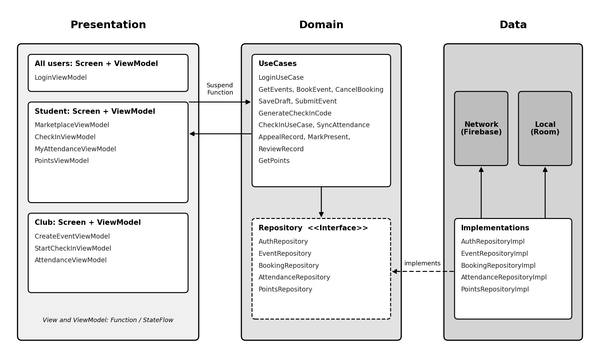
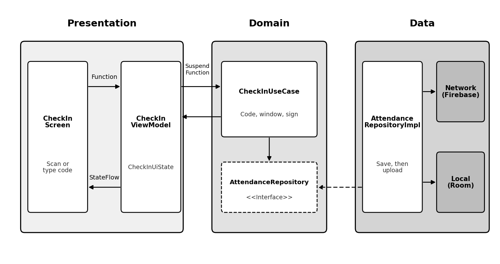

# Part 1 Report
# R4: Online and Offline

## R4 S1 – Offline check-in
**Priority:** Must have

**User story:** As a student, I want to check in without signal, so that I still get credit.

**Acceptance criteria**

- AC1: Given I am offline and booked, When I scan, Then it is signed and saved within 1 second as "Saved on this phone, waiting to sync".

**Exception cases**

- EX1: Given the phone never registered online, When I scan, Then I must connect once first.
- EX2: Given storage is full or the app closes mid-save, When I reopen, Then a record is complete or absent, never half-written.

## R4 S2 – Sync and status
**Priority:** Must have

**User story:** As a student, I want to see what has synced, so that I know my attendance counts.

**Acceptance criteria**

- AC1: Given waiting records, When a connection returns, Then upload starts within 60 seconds, never twice; each record shows one status (Pending, Syncing, Verified, Needs review, Rejected, Couldn't sync) with a waiting banner.

**Exception cases**

- EX1: Given 5 failed uploads, When I open My attendance, Then it shows "Couldn't sync" with Retry (backoff 30 seconds, doubling).
- EX2: Given unsynced records, When I log out, Then I am warned and data is kept.

## R4 S3 – Late sync of an on-time scan
**Priority:** Must have

**User story:** As a student, I want on-time scans to count even if synced late, so that weak signal doesn't cost points.

**Acceptance criteria**

- AC1: Given I sync within 72 hours of the event ending, When judged, Then the time inside the signed code decides.

**Exception cases**

- EX1: Given I sync after 72 hours, When checked, Then it is Rejected ("Synced too late") with an appeal option.

## R4 S4 – Edited or replayed records
**Priority:** Must have

**User story:** As the system, I want faked offline records rejected, so that attendance can't be inflated.

**Acceptance criteria**

- AC1: Given a record signed with an Android Keystore key, When it is edited, Then the signature fails and it is rejected and the account flagged.

**Exception cases**

- EX1: Given a duplicate, When it arrives, Then it is rejected; if only the reply was lost, the server returns the original result.

## R4 S5 – Organiser runs check-in offline
**Priority:** Must have

**User story:** As a club organiser, I want check-in without signal, so that a weak venue connection doesn't stop my event.

**Acceptance criteria**

- AC1: Given the event was loaded online beforehand, When the venue has no internet, Then the rotating and 6-digit codes keep working.

**Exception cases**

- EX1: Given I reconnect, When the event has ended, Then the session log of code displays uploads so student scans can be verified.

# R5: Points and Progress

## R5 S1 – Total and history
**Priority:** Must have

**User story:** As a student, I want to see my points, so that I know how far I've got.

**Acceptance criteria**

- AC1: Given points, When I open the app, Then the total equals credits minus reversals, and the history shows Pending (with a reason), Credited or Reversed.

**Exception cases**

- EX1: Given I am offline, When I open Points, Then the last known total shows with "Last updated".

## R5 S2 – When points are credited
**Priority:** Must have

**User story:** As a student, I want points only for genuine attendance, so that my record is respected.

**Acceptance criteria**

- AC1: Given a Verified record and the event ended, When points are processed, Then exactly one credit is created within 1 hour.

**Exception cases**

- EX1: Given a rejected, missing or cancelled record, or processing runs twice, When processed, Then at most one credit exists.
- EX2: Given a modified app or organiser request changes points, When it arrives, Then it is denied and logged; admin corrections are new entries.

## R5 S3 – Reversal and appeal
**Priority:** Must have

**User story:** As a student, I want to be told if points are removed and to appeal, so that mistakes can be corrected.

**Acceptance criteria**

- AC1: Given a record later found invalid, When reversed, Then the original credit stays visible, my total drops and I'm notified.
- AC2: Given I appeal (once, within 14 days), When reviewed, Then the admin decides within 5 working days, never the club.

**Exception cases**

- EX1: Given a second reversal, When attempted, Then it is refused.

## R5 S4 – Gamification
**Priority:** Nice to have

**User story:** As a student, I want levels, badges and progress, so that I stay motivated.

**Acceptance criteria**

- AC1: Given credited points, When I open Points, Then a progress bar, category breakdown, level and badges show.

**Exception cases**

- EX1: Given a reversal drops me below a level, When it happens, Then my level and badges recalculate and I'm told why.

# R6: Roles and Access

## R6 S1 – Register and log in
**Priority:** Must have

**User story:** As a student, I want to register with my university email, so that only I see my data.

**Acceptance criteria**

- AC1: Given a university email, When I register, Then it is verified within 24 hours, I accept the privacy notice (PDPA) and the account activates as a student.
- AC2: Given 5 wrong passwords, When I try again, Then I'm blocked for 15 minutes.

**Exception cases**

- EX1: Given an unregistered email, When I log in, Then I see the same generic error.

## R6 S2 – Role separation
**Priority:** Must have

**User story:** As the system, I want each role to do only what it is allowed, so that nobody gains higher access.

**Acceptance criteria**

- AC1: Given a role, When I use the app, Then I see only my screens; a student or another club requesting club data is denied.

**Exception cases**

- EX1: Given a registration with a "role" field, When received, Then it is ignored; club accounts are created only by the office, linked to one club.

## R6 S3 – One phone per account
**Priority:** Must have

**User story:** As a student, I want check-in on one registered phone, so that nobody checks in as me elsewhere.

**Acceptance criteria**

- AC1: Given my first online login, When I register, Then a Keystore key is created and only the public key is sent.

**Exception cases**

- EX1: Given a second or unregistered phone, When I check in, Then it is rejected; I can still view data.

## R6 S4 – Study details
**Priority:** Must have

**User story:** As an s-CPD admin, I want each student's year, degree and start year, so that I can tell whether their email should still be active.

**Acceptance criteria**

- AC1: Given the details are saved, When calculated, Then the expected end year comes from the start year and degree length.

**Exception cases**

- EX1: Given details that don't fit (year 4 on a 3-year degree), When I save, Then I see "These details do not match".
- EX2: Given resits or an extension, When the period has ended, Then the account is "Waiting for approval" and the admin sets a new end date.

## R6 S5 – Deactivate graduated accounts
**Priority:** Must have

**User story:** As an s-CPD admin, I want ended accounts flagged then deactivated, so that former students stop using the system.

**Acceptance criteria**

- AC1: Given the end date is within 30 days, When the daily check runs, Then a warning is sent; once passed it is flagged, and after 30 more days unextended it is deactivated with records kept.

**Exception cases**

- EX1: Given the email bounces 3 times, When flagged, Then an admin confirms before deactivation.
- EX2: Given deactivation, When saved, Then future bookings are cancelled and places released.

## R6 S6 – Admin tool and audit log
**Priority:** Must have

**User story:** As an s-CPD admin, I want one admin tool, so that approvals, appeals and account actions are testable and traceable.

**Acceptance criteria**

- AC1: Given an admin sign-in with a second step, When I act (approve events, decide appeals, disable accounts, release phones), Then a target and reason are required and an immutable audit entry is written.

**Exception cases**

- EX1: Given a non-admin sign-in, When attempted, Then it is denied and logged.
- EX2: Given the audit log can't be written, When an action is requested, Then it is not carried out.

# Non-Functional Requirements

- **Usability:** 90% of first-time users submit events within 3 minutes and book within 60 seconds, unaided.
- **Performance:** Marketplace loads within 2s, search within 1s, check-in within 2s, points within 3s and admin decisions within 5s (95% of cases).
- **Reliability:** Prevent overbooking; preserve attendance through crashes; reconcile points; rotate codes without skips.
- **Security:** Enforce role-based access and reject forged, expired, duplicate and out-of-window check-ins; encrypt sensitive data.
- **Accessibility and compatibility:** WCAG 2.1 AA, TalkBack, 48dp minimum touch targets and Android 12+; support portrait and landscape.
- **Audit and retention:** Log administrative and attendance actions; retain and delete personal data according to PDPA requirements.

# Challenges and Assumptions

## Challenges and Mitigations

- **Approval bypass (R1):** Deny-by-default rules, locked fields and automated tests prevent unauthorised approvals or point changes.
- **Slow reviews (R1):** Admin tools, prioritised queues and automatic event expiry reduce delays.
- **Overbooking (R2):** Server-side transactions and concurrency tests protect capacity.
- **Emulator limitations (R3, R4):** Test camera, GPS and Keystore limitations using fallback codes and physical devices.
- **Attendance verification (R3):** Prototype rotating QR validation and clock synchronisation; use grace periods and manual marking.
- **Offline cheating (R3, R4):** Signed records, session logs and organiser review reduce forgery and replay risks, though real-time code sharing remains possible.
- **Attendance synchronisation (R4):** Atomic local storage, retries and duplicate detection reduce lost or repeated records.
- **Late sync and cancellations (R4):** Apply sync deadlines and online-only cancellation cut-offs.
- **Points processing (R5):** Append-only records, server-side processing and appeals mitigate duplicate credits and incorrect reversals.
- **Missed notifications (R5):** Use in-app notifications and retries.
- **Role bypass and account sharing (R6):** Enforce backend roles, audit actions and register devices.
- **Privacy compliance (R6):** Apply data minimisation, consent, retention limits and deletion policies.
- **Former student access (R6):** Verify enrolment, check expiry and deactivate eligible accounts.

## Assumptions

- The s-CPD office confirms settings: 1–10 points per event, a 15-minute grace period and a 2-hour booking cut-off.
- Admins use a separate tool; points and deadlines are configurable.
- Students register with university email; the office creates club accounts and supplies degree details.
- Clubs use Android phones; events are loaded online beforehand and devices have sufficient battery.
- Events are in person, use Malaysia Time, last under one day and have a venue when location is checked.
- Devices run Android 12+. Students unable to scan may use a 6-digit code or organiser marking.
- QR codes rotate every 15 seconds; current and previous codes remain valid for up to 30 seconds. The fallback code follows the same rules.
- Check-in runs from event start until 15 minutes after it ends. Offline records must sync within 72 hours of event end; server time determines deadlines.
- University staff review appeals and flagged records.
- Waitlisted students are booked automatically when accepted.
- Students protect their credentials and phones; misuse cannot be prevented if both are shared.

# Justification of Attendance Technology

Rotating QR codes were selected because they are inexpensive, widely compatible with Android cameras, scalable and easy to demonstrate using a 6-digit emulator fallback. Short validity periods, signed counters and offline verification improve security.

Bluetooth was rejected because proximity does not prove attendance. NFC offers closer-range verification but requires compatible devices and physical readers, potentially slowing large events. GPS is unreliable indoors and only establishes proximity to a venue.

QR codes can still be forwarded in real time. Device-bound signatures, booking validation, offline signing, session logs, organiser review and optional location flags reduce this risk. Overall, rotating QR codes balance security, usability, cost, compatibility and implementation complexity.

# Own Features

## 1. Gamification and Milestone Badging

**Description:** Encourages participation through points, levels, titles and achievement badges.

**Key features:**
- Award points and automatically update levels based on thresholds.
- Display level, title, total points and progress on the personal centre page.
- Award badges for participation, community service and leadership milestones.
- Visualise competency progress using statistics and MPAndroidChart radar charts.

**Benefits:** Motivates participation and helps students track engagement and personal development.

## 2. Smart Reminders and Check-in Alerts

**Description:** Helps students remember events, check in on time and release unwanted bookings.

**Key features:**
- Schedule local notifications 24 and 3 hours before confirmed events.
- Add a "Can't make it" cancellation action to the 3-hour reminder.
- Release cancelled places to eligible waitlisted students and update statuses.
- Queue cancellations or show pending confirmation when offline.
- Notify students when check-in opens and link to the relevant screen.

**Scope and limitations:** Reminders work offline subject to permissions and device settings. Email and SMS are excluded; cancellations and waitlist updates may require internet access.

**Benefits:** Reduces missed events and unused places, improves punctuality and simplifies booking management.

### Architecture

The s-CPD app uses **MVVM (Model-View-ViewModel) with Clean Architecture**, separating the application into Presentation, Domain and Data layers to improve maintainability, testability and separation of concerns.

Figure 1 shows the overall architecture. The Presentation layer manages UI interactions and state, the Domain layer contains use cases and repository interfaces, and the Data layer implements repositories and manages local and remote data sources.

The check-in feature illustrates how these layers interact.

#### How a Check-in Moves Through the Layers

1. The student scans a club QR code or enters the 6-character code. `CheckInScreen` calls `CheckInViewModel`.
2. `CheckInViewModel` invokes `CheckInUseCase` through a suspend function, keeping the UI responsive.
3. `CheckInUseCase` validates the event, code validity window and phone-key signature, then saves the record through the `AttendanceRepository` interface.
4. `AttendanceRepositoryImpl` saves the record locally using Room, enabling offline check-in, and uploads it to Firebase when connectivity returns.
5. `CheckInViewModel` exposes `CheckInUiState` through `StateFlow`, such as "Saved on this phone, waiting to sync". `CheckInScreen` updates accordingly.

### Design Decisions and Trade-offs

#### Backend Selection
Firebase provides authentication, database services, synchronisation and security with less development effort than a custom backend.

#### Architectural Pattern
MVVM separates UI and business logic while keeping complexity manageable. MVP requires more manual lifecycle handling, whereas MVI introduces unnecessary complexity for this project.

#### Local Data Storage
Room supports relational queries and transactions for bookings, attendance and sync queues. DataStore is better suited to simple settings.

#### Points Processing and Ledger
Points use an append-only ledger of credits and reversals. Corrections create new entries, preserving traceability for appeals and audits.### Architecture

## Data model

## Offline strategy

Room stores event details, bookings, the club's signed QR session data and pending attendance records locally. Students and clubs must connect online beforehand to download the required data and register their devices.

1. **Record:** When a student scans a QR code offline, the app checks the code's validity against the locally stored session data and confirms that the student has a booking. The check-in is signed using the device's Android Keystore key and saved atomically in Room as Pending sync.

2. **Display status:** The app distinguishes Pending sync, Syncing, Verified, Needs review, Rejected and Couldn't sync, so students know whether attendance has been confirmed.

3. **Synchronise:** When connectivity returns, the app uploads pending records automatically within 60 seconds. Retries use exponential backoff, and unique record IDs prevent duplicate processing.

4. **Verify:** Firebase checks the device signature, event and booking details, code validity, event window, club session log, and duplicate records. Unverifiable records are flagged for review rather than automatically credited.

5. **Resolve:** Records must sync within 72 hours of the event ending. Valid records become Verified; invalid or late records are rejected with a reason and an appeal option. Points are credited only after verification and event completion.

If the app closes or the phone loses power, atomic database transactions ensure a record is either saved completely or not saved. Unsynchronised records remain stored across app restarts.

###Wireframes

