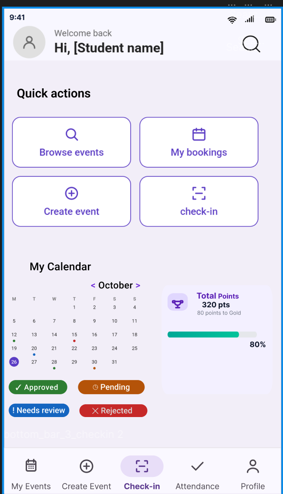
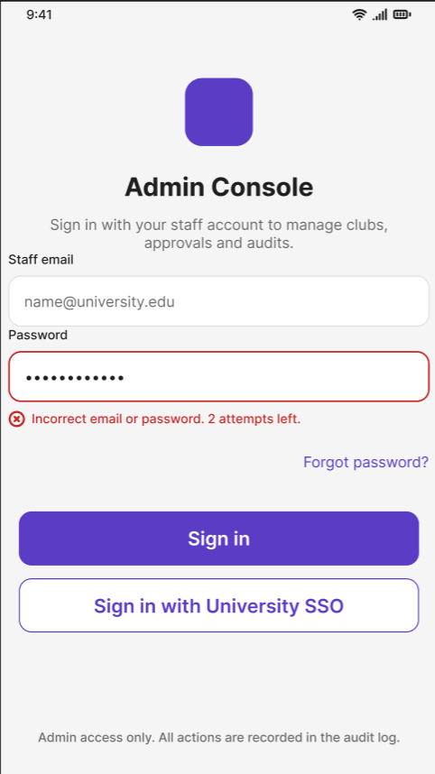
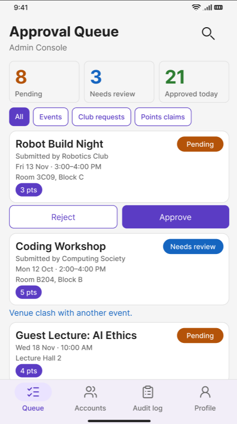
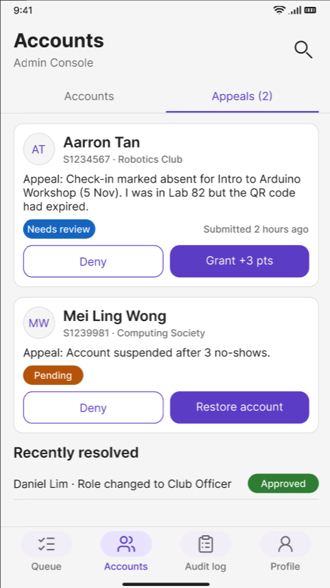
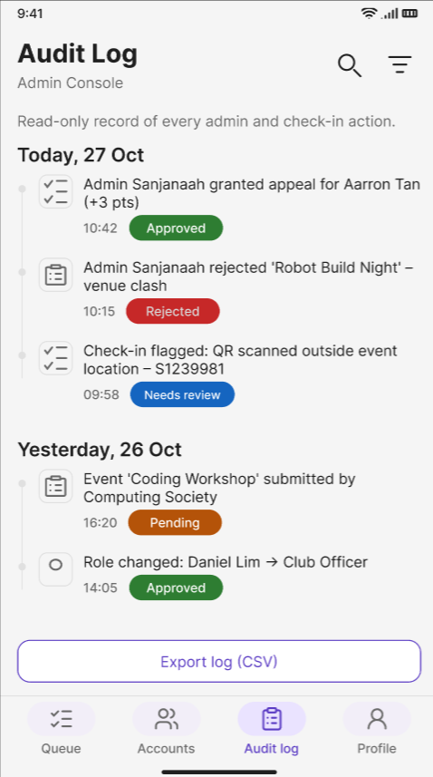
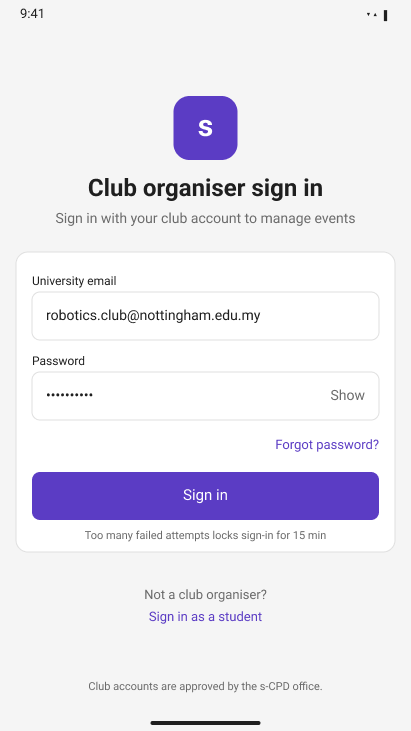
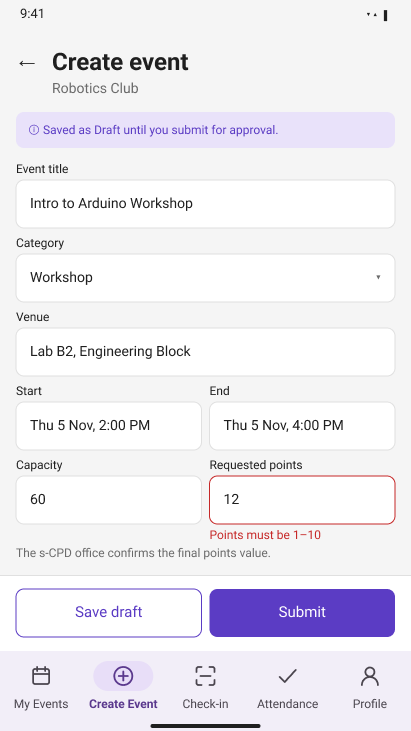
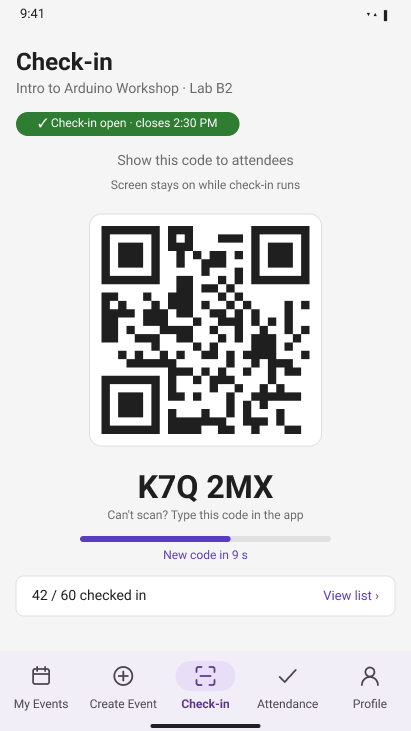
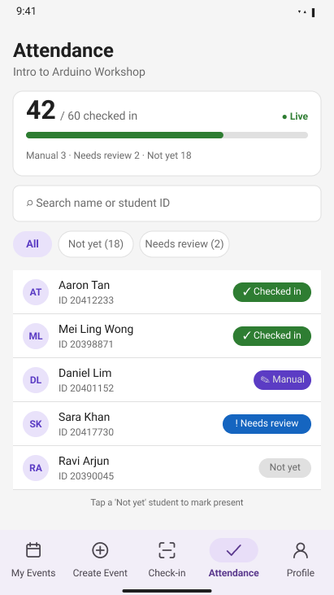

# Part 1 Report
## Table of Contents
1. [Requirements Analysis (R1–R3)](https://github.com/Shreya-1910/mobile-device-programming#requirements-analysis-r1r3)
2. [R4: Online and Offline](https://github.com/Shreya-1910/mobile-device-programming#r4-online-and-offline)
3. [R5: Points and Progress](https://github.com/Shreya-1910/mobile-device-programming#r5-points-and-progress)
4. [R6: Roles and Access](https://github.com/Shreya-1910/mobile-device-programming#r6-roles-and-access)
5. [Non-Functional Requirements](https://github.com/Shreya-1910/mobile-device-programming#non-functional-requirements)
6. [Attendance Security](https://github.com/Shreya-1910/mobile-device-programming#attendance-security-r3-r4)
7. [Challenges and Assumptions](https://github.com/Shreya-1910/mobile-device-programming#challenges-and-assumptions)
8. [Justification of Attendance Technology](https://github.com/Shreya-1910/mobile-device-programming#justification-of-attendance-technology)
9. [Own Features](https://github.com/Shreya-1910/mobile-device-programming#own-features)
10. [Architecture](https://github.com/Shreya-1910/mobile-device-programming#architecture)
11. [Design System](https://www.figma.com/design/6z2DTyn9ipP83E4EA2nGPJ/MDP?node-id=194-1302&t=WtO7yMKTm3fSBXUz-4)
12. [Wireframes](https://github.com/Shreya-1910/mobile-device-programming#wireframes)

# Requirements Analysis (R1–R3)

R1–R3 has 38 user stories (29 must-have, 9 nice-to-have), including 9 exceptional cases and 10 cheating attempts. The key stories are below; all stories, acceptance criteria and NFRs are in [research.md](docs/research.md).

### R1 – Event Approval
Events move **Draft → Pending → Approved / Rejected**. The s-CPD administrator decides in a separate admin tool.

- **R1-S4 · Approve an event (Must):** *As an s-CPD administrator, I want to approve an event and confirm its points so that it is published.*
  Approval publishes the event and creates its check-in secret. Each decision is audit-logged and due within 5 working days.
- **R1-S6 · Editing locked after submission (Must):** *As a club organiser, I want to know a submitted event is locked so that I know how to change it.*
  No Edit button after submission. To change an event, the club cancels it and resubmits.
- **R1-S7 · Bypassing approval (Must):** *As the system, I want changes outside the workflow rejected so that clubs can't self-approve or inflate points.*
  Security rules block changes to status, points, time or capacity after submission, even from a modified app.

### R2 – Marketplace and Booking
Students find events through search, filters and a "For you" row.

- **R2-S4 · Book a place (Must):** *As a student, I want one-tap booking so that my place is guaranteed.*
  A server transaction reserves exactly one place. Booking closes 2 h before the start.
- **R2-S5 · Event full (Must):** *As a student, I want a waitlist for full events so that I can attend if someone cancels.*
  When a place frees up, the first student in line is booked automatically and notified.
- **R2-S7 · Booking clash (Must):** *As a student, I want overlapping bookings flagged so that I don't double-book.*
  I can keep my booking or swap in one step, and the server rejects overlaps.

### R3 – Secure Attendance
The club's phone shows a **signed QR code that changes every 15 s** (valid ≤ 30 s), with a 6-digit fallback code. The server checks the signature, time window, booking, registered device and duplicates.

- **R3-S2 · Scan to check in (Must):** *As a student, I want to check in within seconds so that I don't hold up the queue.*
  The result appears within 2 s: **Verified** online, or **Pending** (saved on the phone, synced later) offline.
- **R3-S7 · Screenshot sent to an absent friend (Must):** *As the system, I want copied codes to expire quickly so that nobody checks in from home.*
  Online, a code works for only 30 s. Offline records must match the club's session log. **Known weakness:** a live code forwarded and scanned offline can pass, so it's only flagged by location or a scan count above headcount.
- **R3-S10 · Checking in for a friend (Must):** *As the system, I want each check-in tied to one student and device so that nobody checks in others.*
  Each check-in is limited to one per device per event and signed by the student's registered phone key. **Weakness:** a friend carrying the student's own unlocked phone.

# R4: Online and Offline

## R4 S1 – Offline check-in
**Priority:** Must have

**User story:** As a student, I want to check in without signal, so that I still get credit.

**Acceptance criteria**

- AC1: Given I am offline and booked, When I scan, Then it is signed and saved within 1 second as "Saved on this phone, waiting to sync".

**Exception cases**

- EX1: Given the phone never registered online, When I scan, Then I must connect once first.
- EX2: Given storage is full or the app closes mid-save, When I reopen, Then a record is complete or absent, never half-written.

## R4 S2 – Sync and status
**Priority:** Must have

**User story:** As a student, I want to see what has synced, so that I know my attendance counts.

**Acceptance criteria**

- AC1: Given waiting records, When a connection returns, Then upload starts within 60 seconds, never twice; each record shows one status (Pending, Syncing, Verified, Needs review, Rejected, Couldn't sync) with a waiting banner.

**Exception cases**

- EX1: Given 5 failed uploads, When I open My attendance, Then it shows "Couldn't sync" with Retry (backoff 30 seconds, doubling).
- EX2: Given unsynced records, When I log out, Then I am warned and data is kept.

## R4 S3 – Late sync of an on-time scan
**Priority:** Must have

**User story:** As a student, I want on-time scans to count even if synced late, so that weak signal doesn't cost points.

**Acceptance criteria**

- AC1: Given I sync within 72 hours of the event ending, When judged, Then the time inside the signed code decides.

**Exception cases**

- EX1: Given I sync after 72 hours, When checked, Then it is Rejected ("Synced too late") with an appeal option.

## R4 S4 – Edited or replayed records
**Priority:** Must have

**User story:** As the system, I want faked offline records rejected, so that attendance can't be inflated.

**Acceptance criteria**

- AC1: Given a record signed with an Android Keystore key, When it is edited, Then the signature fails and it is rejected and the account flagged.

**Exception cases**

- EX1: Given a duplicate, When it arrives, Then it is rejected; if only the reply was lost, the server returns the original result.

## R4 S5 – Organiser runs check-in offline
**Priority:** Must have

**User story:** As a club organiser, I want check-in without signal, so that a weak venue connection doesn't stop my event.

**Acceptance criteria**

- AC1: Given the event was loaded online beforehand, When the venue has no internet, Then the rotating and 6-digit codes keep working.

**Exception cases**

- EX1: Given I reconnect, When the event has ended, Then the session log of code displays uploads so student scans can be verified.

# R5: Points and Progress

## R5 S1 – Total and history
**Priority:** Must have

**User story:** As a student, I want to see my points, so that I know how far I've got.

**Acceptance criteria**

- AC1: Given points, When I open the app, Then the total equals credits minus reversals, and the history shows Pending (with a reason), Credited or Reversed.

**Exception cases**

- EX1: Given I am offline, When I open Points, Then the last known total shows with "Last updated".

## R5 S2 – When points are credited
**Priority:** Must have

**User story:** As a student, I want points only for genuine attendance, so that my record is respected.

**Acceptance criteria**

- AC1: Given a Verified record and the event ended, When points are processed, Then exactly one credit is created within 1 hour.

**Exception cases**

- EX1: Given a rejected, missing or cancelled record, or processing runs twice, When processed, Then at most one credit exists.
- EX2: Given a modified app or organiser request changes points, When it arrives, Then it is denied and logged; admin corrections are new entries.

## R5 S3 – Reversal and appeal
**Priority:** Must have

**User story:** As a student, I want to be told if points are removed and to appeal, so that mistakes can be corrected.

**Acceptance criteria**

- AC1: Given a record later found invalid, When reversed, Then the original credit stays visible, my total drops and I'm notified.
- AC2: Given I appeal (once, within 14 days), When reviewed, Then the admin decides within 5 working days, never the club.

**Exception cases**

- EX1: Given a second reversal, When attempted, Then it is refused.

## R5 S4 – Gamification
**Priority:** Nice to have

**User story:** As a student, I want levels, badges and progress, so that I stay motivated.

**Acceptance criteria**

- AC1: Given credited points, When I open Points, Then a progress bar, category breakdown, level and badges show.

**Exception cases**

- EX1: Given a reversal drops me below a level, When it happens, Then my level and badges recalculate and I'm told why.

# R6: Roles and Access

## R6 S1 – Register and log in
**Priority:** Must have

**User story:** As a student, I want to register with my university email, so that only I see my data.

**Acceptance criteria**

- AC1: Given a university email, When I register, Then it is verified within 24 hours, I accept the privacy notice (PDPA) and the account activates as a student.
- AC2: Given 5 wrong passwords, When I try again, Then I'm blocked for 15 minutes.

**Exception cases**

- EX1: Given an unregistered email, When I log in, Then I see the same generic error.

## R6 S2 – Role separation
**Priority:** Must have

**User story:** As the system, I want each role to do only what it is allowed, so that nobody gains higher access.

**Acceptance criteria**

- AC1: Given a role, When I use the app, Then I see only my screens; a student or another club requesting club data is denied.

**Exception cases**

- EX1: Given a registration with a "role" field, When received, Then it is ignored; club accounts are created only by the office, linked to one club.

## R6 S3 – One phone per account
**Priority:** Must have

**User story:** As a student, I want check-in on one registered phone, so that nobody checks in as me elsewhere.

**Acceptance criteria**

- AC1: Given my first online login, When I register, Then a Keystore key is created and only the public key is sent.

**Exception cases**

- EX1: Given a second or unregistered phone, When I check in, Then it is rejected; I can still view data.

## R6 S4 – Study details
**Priority:** Must have

**User story:** As an s-CPD admin, I want each student's year, degree and start year, so that I can tell whether their email should still be active.

**Acceptance criteria**

- AC1: Given the details are saved, When calculated, Then the expected end year comes from the start year and degree length.

**Exception cases**

- EX1: Given details that don't fit (year 4 on a 3-year degree), When I save, Then I see "These details do not match".
- EX2: Given resits or an extension, When the period has ended, Then the account is "Waiting for approval" and the admin sets a new end date.

## R6 S5 – Deactivate graduated accounts
**Priority:** Must have

**User story:** As an s-CPD admin, I want ended accounts flagged then deactivated, so that former students stop using the system.

**Acceptance criteria**

- AC1: Given the end date is within 30 days, When the daily check runs, Then a warning is sent; once passed it is flagged, and after 30 more days unextended it is deactivated with records kept.

**Exception cases**

- EX1: Given the email bounces 3 times, When flagged, Then an admin confirms before deactivation.
- EX2: Given deactivation, When saved, Then future bookings are cancelled and places released.

## R6 S6 – Admin tool and audit log
**Priority:** Must have

**User story:** As an s-CPD admin, I want one admin tool, so that approvals, appeals and account actions are testable and traceable.

**Acceptance criteria**

- AC1: Given an admin sign-in with a second step, When I act (approve events, decide appeals, disable accounts, release phones), Then a target and reason are required and an immutable audit entry is written.

**Exception cases**

- EX1: Given a non-admin sign-in, When attempted, Then it is denied and logged.
- EX2: Given the audit log can't be written, When an action is requested, Then it is not carried out.

# Non-Functional Requirements

- **Usability:** 90% of first-time users submit events within 3 minutes and book within 60 seconds, unaided.
- **Performance:** Marketplace loads within 2s, search within 1s, check-in within 2s, points within 3s and admin decisions within 5s (95% of cases).
- **Reliability:** Prevent overbooking; preserve attendance through crashes; reconcile points; rotate codes without skips.
- **Security:** Enforce role-based access and reject forged, expired, duplicate and out-of-window check-ins; encrypt sensitive data.
- **Accessibility and compatibility:** WCAG 2.1 AA, TalkBack, 48dp minimum touch targets and Android 12+; support portrait and landscape.
- **Audit and retention:** Log administrative and attendance actions; retain and delete personal data according to PDPA requirements.

# Attendance Security (R3, R4)

Each check-in must pass five server checks:
- a **signed code** (HMAC with a per-event secret that students never receive);
- a **time window** read from the code, not the phone clock;
- a **booking**;
- a **registered phone** (Keystore-signed record);
- **one record per student per event**.

This blocks remote, late, forged and replayed check-ins. Cheating by people in the room is made difficult and auditable rather than impossible.

| Attack | How it's prevented | What remains |
|---|---|---|
| Screenshot sent to an absent friend | The code changes every 15 s and is valid for ≤ 30 s | A code relayed live within 30 s |
| Same, but scanned **offline** | The code must appear in the club's session log | Can pass, so it's caught only by the location flag or by scans exceeding the headcount |
| Checking in a friend | One registered phone per account, one check-in per device per event, optional fingerprint/PIN | A friend carrying the student's own unlocked phone |
| Late check-in or changed phone clock | The server checks the signed time window | None significant |
| Forged, guessed or edited codes and records | HMAC signing; lock after 5 wrong codes; signed offline records | A club member leaking the secret (one event only) |
| Modified app or direct API calls | Firestore rules and Cloud Functions, with automated tests | Rule mistakes, caught by the tests |
| Walk-ins and club favouritism | Walk-ins held as Needs review; manual marks audit-logged and flagged above 20% | Collusion is made visible, not stopped |

**Honest limits:** a QR code proves a registered phone saw a genuine code. It can't prove who is holding the phone, or when an offline scan happened. These cases are flagged for review, not silently accepted. All 14 attacks are in the [full analysis](docs/attendance-security.md).

# Challenges and Assumptions

## Challenges and Mitigations

- **Approval bypass (R1):** Deny-by-default rules, locked fields and automated tests prevent unauthorised approvals or point changes.
- **Slow reviews (R1):** Admin tools, prioritised queues and automatic event expiry reduce delays.
- **Overbooking (R2):** Server-side transactions and concurrency tests protect capacity.
- **Emulator limitations (R3, R4):** Test camera, GPS and Keystore limitations using fallback codes and physical devices.
- **Attendance verification (R3):** Prototype rotating QR validation and clock synchronisation; use grace periods and manual marking.
- **Offline cheating (R3, R4):** Signed records, session logs and organiser review reduce forgery and replay risks, though real-time code sharing remains possible.
- **Attendance synchronisation (R4):** Atomic local storage, retries and duplicate detection reduce lost or repeated records.
- **Late sync and cancellations (R4):** Apply sync deadlines and online-only cancellation cut-offs.
- **Points processing (R5):** Append-only records, server-side processing and appeals mitigate duplicate credits and incorrect reversals.
- **Missed notifications (R5):** Use in-app notifications and retries.
- **Role bypass and account sharing (R6):** Enforce backend roles, audit actions and register devices.
- **Privacy compliance (R6):** Apply data minimisation, consent, retention limits and deletion policies.
- **Former student access (R6):** Verify enrolment, check expiry and deactivate eligible accounts.

## Assumptions

- The s-CPD office confirms settings: 1–10 points per event, a 15-minute grace period and a 2-hour booking cut-off.
- Admins use a separate tool; points and deadlines are configurable.
- Students register with university email; the office creates club accounts and supplies degree details.
- Clubs use Android phones; events are loaded online beforehand and devices have sufficient battery.
- Events are in person, use Malaysia Time, last under one day and have a venue when location is checked.
- Devices run Android 12+. Students unable to scan may use a 6-digit code or organiser marking.
- QR codes rotate every 15 seconds; current and previous codes remain valid for up to 30 seconds. The fallback code follows the same rules.
- Check-in runs from event start until 15 minutes after it ends. Offline records must sync within 72 hours of event end; server time determines deadlines.
- University staff review appeals and flagged records.
- Waitlisted students are booked automatically when accepted.
- Students protect their credentials and phones; misuse cannot be prevented if both are shared.

# Justification of Attendance Technology

Rotating QR codes were selected because they are inexpensive, widely compatible with Android cameras, scalable and easy to demonstrate using a 6-digit emulator fallback. Short validity periods, signed counters and offline verification improve security.

Bluetooth was rejected because proximity does not prove attendance. NFC offers closer-range verification but requires compatible devices and physical readers, potentially slowing large events. GPS is unreliable indoors and only establishes proximity to a venue.

QR codes can still be forwarded in real time. Device-bound signatures, booking validation, offline signing, session logs, organiser review and optional location flags reduce this risk. Overall, rotating QR codes balance security, usability, cost, compatibility and implementation complexity.

# Own Features

## 1. Gamification and Milestone Badging

**Description:** Encourages participation through points, levels, titles and achievement badges.

**Key features:**
- Award points and automatically update levels based on thresholds.
- Display level, title, total points and progress on the personal centre page.
- Award badges for participation, community service and leadership milestones.
- Visualise competency progress using statistics and MPAndroidChart radar charts.

**Benefits:** Motivates participation and helps students track engagement and personal development.

## 2. Smart Reminders and Check-in Alerts

**Description:** Helps students remember events, check in on time and release unwanted bookings.

**Key features:**
- Schedule local notifications 24 and 3 hours before confirmed events.
- Add a "Can't make it" cancellation action to the 3-hour reminder.
- Release cancelled places to eligible waitlisted students and update statuses.
- Queue cancellations or show pending confirmation when offline.
- Notify students when check-in opens and link to the relevant screen.

**Scope and limitations:** Reminders work offline subject to permissions and device settings. Email and SMS are excluded; cancellations and waitlist updates may require internet access.

**Benefits:** Reduces missed events and unused places, improves punctuality and simplifies booking management.

### Architecture

The s-CPD app uses **MVVM (Model-View-ViewModel) with Clean Architecture**, separating the application into Presentation, Domain and Data layers to improve maintainability, testability and separation of concerns.

Figure 1 shows the overall architecture. The Presentation layer manages UI interactions and state, the Domain layer contains use cases and repository interfaces, and the Data layer implements repositories and manages local and remote data sources.

The check-in feature illustrates how these layers interact.

#### How a Check-in Moves Through the Layers

1. The student scans a club QR code or enters the 6-character code. `CheckInScreen` calls `CheckInViewModel`.
2. `CheckInViewModel` invokes `CheckInUseCase` through a suspend function, keeping the UI responsive.
3. `CheckInUseCase` validates the event, code validity window and phone-key signature, then saves the record through the `AttendanceRepository` interface.
4. `AttendanceRepositoryImpl` saves the record locally using Room, enabling offline check-in, and uploads it to Firebase when connectivity returns.
5. `CheckInViewModel` exposes `CheckInUiState` through `StateFlow`, such as "Saved on this phone, waiting to sync". `CheckInScreen` updates accordingly.

### Design Decisions and Trade-offs

#### Backend Selection
Firebase provides authentication, database services, synchronisation and security with less development effort than a custom backend.

#### Architectural Pattern
MVVM separates UI and business logic while keeping complexity manageable. MVP requires more manual lifecycle handling, whereas MVI introduces unnecessary complexity for this project.

#### Local Data Storage
Room supports relational queries and transactions for bookings, attendance and sync queues. DataStore is better suited to simple settings.

#### Points Processing and Ledger
Points use an append-only ledger of credits and reversals. Corrections create new entries, preserving traceability for appeals and audits.### Architecture

## Data model

## Offline strategy

Room stores event details, bookings, the club's signed QR session data and pending attendance records locally. Students and clubs must connect online beforehand to download the required data and register their devices.

1. **Record:** When a student scans a QR code offline, the app checks the code's validity against the locally stored session data and confirms that the student has a booking. The check-in is signed using the device's Android Keystore key and saved atomically in Room as Pending sync.

2. **Display status:** The app distinguishes Pending sync, Syncing, Verified, Needs review, Rejected and Couldn't sync, so students know whether attendance has been confirmed.

3. **Synchronise:** When connectivity returns, the app uploads pending records automatically within 60 seconds. Retries use exponential backoff, and unique record IDs prevent duplicate processing.

4. **Verify:** Firebase checks the device signature, event and booking details, code validity, event window, club session log, and duplicate records. Unverifiable records are flagged for review rather than automatically credited.

5. **Resolve:** Records must sync within 72 hours of the event ending. Valid records become Verified; invalid or late records are rejected with a reason and an appeal option. Points are credited only after verification and event completion.

If the app closes or the phone loses power, atomic database transactions ensure a record is either saved completely or not saved. Unsynchronised records remain stored across app restarts.

# Design System

**Owner:** Ziad

**Figma:** [Design System page](https://www.figma.com/design/6z2DTyn9ipP83E4EA2nGPJ/MDP?node-id=194-1302&t=WtO7yMKTm3fSBXUz-4)

**Frame size:** Pixel 2 (411 × 731 dp)

**Font:** Roboto (Android default)

Every screen in the app is built from one shared set of colours, text styles and components. This keeps the student, club and admin screens consistent, so they look and behave like one app. Teammates copy components from the Design System page instead of drawing their own, and changing a main component updates every screen that uses it.

---

## 1. Colours

The palette is deliberately small: one brand colour, neutral colours for text and backgrounds, and four fixed status colours. Each status colour always means the same thing on every screen, so users only need to learn it once.

| Style | Hex | Used for |
|---|---|---|
| Primary | `#4E32B0` | Main buttons, active navigation, links, points badge |
| Text | `#1F1F1F` | Main text |
| Text Secondary | `#6B6B6B` | Dates, labels, placeholders |
| Border | `#E0E0E0` | Card and field outlines, disabled buttons |
| Surface | `#F5F5F5` | Screen background, secondary badges |
| Status / Verified | `#2E7D32` | Approved, Verified, Checked in, Credited |
| Status / Pending | `#B45309` | Pending, Syncing |
| Status / Rejected | `#C62828` | Rejected, Reversed, errors, destructive actions |
| Status / Needs review | `#1565C0` | Needs review |

**Accessibility:** status is never shown by colour alone. Every status chip combines colour, icon and word (e.g. ✓ Verified), so it remains clear for colour-blind users.

---

## 2. Typography

Five text styles in Roboto, Android's default font, create a clear visual hierarchy. The size steps guide the eye from the most important information (points, screen titles) down to smaller details (dates, chip labels).

| Style | Size | Weight | Used for |
|---|---|---|---|
| Big number | 32 | Bold | Points total, attendance count |
| Headline | 24 | Bold | Screen title (once per screen) |
| Title | 18 | SemiBold | Event names, section headers |
| Body | 14 | Regular | Descriptions, field values |
| Label | 12 | Medium | Dates, chips, small details |

**Consistency:** text colours and fonts are always picked from the saved styles, never typed in by hand, so a single change updates the whole app.

---

## 3. Components

Reusable building blocks used across every screen. Components with several versions are built as **variants**, so a teammate can drop one in and switch its type from a dropdown (e.g. Button → Primary / Secondary).

**Actions**

- **Button:** Primary · Secondary · Destructive · Disabled
- **Floating action button:** "+ Create Event" on club screens
- **Text link:** "Forgot password?", "View list ›"

**Status and feedback**

- **Status chip:** Verified · Pending · Rejected · Needs review · Syncing · Draft · Cancelled · Expired · Checked in · Manual · Not yet · Present · Credited · Reversed
- **Info banner and offline banner:** hints and offline notices
- **Empty and error state:** Empty · Error (with Retry)
- **Dialog and bottom sheet:** confirmations and filters

**Inputs and navigation**

- **Text field:** Default · Error
- **Search bar:** searching events, attendees and accounts
- **Filter chip:** Selected · Unselected
- **Tabs:** Selected · Unselected
- **Top app bar:** Default · Back
- **Bottom navigation:** Club (5 variants) · Admin (4 variants)

**Content**

- **Event card:** Approved · Pending · Rejected · Needs review
- **Cards:** Stat tile · Points progress card · Details card
- **List rows:** Attendee · Settings · Activity · Audit entry
- **Small elements:** Avatar · Progress bar · Notification item · Android status bar

### Wireframes
### 1. Student Login

  
  
  

**What it does:**

This is the entry point for students to sign in using their university email and password. Inline validation highlights invalid inputs, while a generic “The email or password is incorrect” message protects account privacy. Consecutive failed attempts trigger a temporary lockout. Offline error handling directs students to contact the office. Gestalt principles were applied to improve the page’s user-friendliness by organising elements into clear visual groups and creating an intuitive, consistent layout

**User-friendly because**
- **Simplicity:** Clearly labelled fields and a primary sign-in action focus on one task.
- **Proximity:** Labels and validation messages appear beside their respective fields.
- **Clear error feedback:** Input errors help students correct mistakes while generic authentication messages protect account privacy.
- **Error recovery:** The offline message provides a clear next step.
- **Security feedback:** The temporary lockout helps protect student accounts.

### 2. Home Page

**What it does:**

The home page provides quick access to key features through labelled action buttons and a bottom navigation bar. Grouped functions apply the Gestalt principle of proximity, while the calendar and colour-coded attendance statuses help students track events and progress at a glance.

**User-friendly because**
- **Clear navigation:** Labelled buttons and consistent navigation help students find features.
- **Proximity:** Grouped functions improve visual organisation.
- **Visual hierarchy:** The calendar and attendance statuses highlight important information.
- **Colour coding:** Status colours make event states easier to distinguish.
- **Consistency:** Familiar layouts make the app easier to learn.

### 3. Event Details

**What it does**

The event details page presents the date, time, location, available places and points awarded. Clear headings, grouped details and consistent colours improve readability.

**User-friendly because**
- **Visual hierarchy:** Headings help students identify key details quickly.
- **Consistency:** Familiar colours and layouts make navigation predictable.
- **Reduced cognitive load:** Essential information is available on one screen.
- **Clear information:** Available places and points help students decide whether to attend.

### 4. My Events

**What it does**

The My Events page displays upcoming and past events, including dates, locations, points and booking statuses. Event cards, colour-coded labels and tabs make information easy to scan.

**User-friendly because**
- **Visual organisation:** Cards and colour-coded labels distinguish event information.
- **Easy navigation:** Tabs separate upcoming and past events.
- **Consistency:** A uniform layout makes event details easy to locate.
- **Reduced cognitive load:** Key information is displayed at a glance.

### 5. Admin Tool

**What it does:**
This is the entry point for staff, and it separates admins from student users. Admins sign in with their staff email and password, or with University SSO as a one-tap alternative. If a login fails, the password field turns red and an inline message explains the problem and how many attempts are left. A "Forgot password?" link offers recovery. The footer reminds admins that all actions are recorded in the audit log.

**User-friendly because**
- **Simplicity:** one task, two fields, one primary action.
- **Proximity:** each label sits directly above its field.
- **Clear error instructions:** the error says what went wrong and how many attempts are left.

### 6. Approval Queue

**What it does:**
This is the admin's home screen, where clubs' submitted events are reviewed before students can book them. Summary cards show the workload at a glance (Pending, Needs review, Approved today). Filter chips narrow the list by request type. Each card shows the event details, the submitting club, the points and a status chip. Approve and Reject buttons sit directly under each card. Rejecting asks for a reason before confirming.

**User-friendly because**
- **Similarity:** every request uses the same card and colour-coded status chip.
- **Show status:** the counts at the top give an instant overview.
- **Proximity:** the actions sit directly under the item they affect.
- **Error prevention:** a reject confirmation with a required reason.

### 7. Accounts & Appeals 

**What it does:**
This screen manages student accounts and the appeals they raise. Tabs switch between Accounts and Appeals, and the Appeals tab shows how many are pending. Each appeal card groups the student's details, their reason, a status chip and when it was submitted. The actions are specific to each case, such as "Grant +3 pts" or "Restore account". A "Recently resolved" section confirms completed decisions.

**User-friendly because**
- **Figure-ground:** white cards on a grey background separate each appeal.
- **Proximity:** the reason, status and decision are grouped in one card.
- **Consistency:** the same buttons and chips are used across the app.
- **Clear feedback:** a confirmation states exactly what will change.

### 8. Audit Log 

**What it does:**
This is a read-only, time-ordered record of every admin and check-in action. Entries are grouped by day along a timeline, and each one shows who did what, when, and the outcome. Suspicious check-ins, such as a QR code scanned outside the event location, are flagged for review. Admins can search, filter by action type, and export the log as CSV.

**User-friendly because**
- **Continuity:** the timeline leads the eye through events in order.
- **Proximity:** entries are grouped by day.
- **Similarity:** the same status chips are used as elsewhere in the app.
- **Show status:** who, what and when are visible for every action, which builds trust in attendance records.

### 9. Club Login

**What it does:**
This is the entry point for club organisers, separate from the student sign-in. Organisers sign in with their club's university email and password. A "Forgot password?" link offers recovery, and a note under the button states the lockout rule (15 minutes after too many failed attempts), so a locked account is never a surprise. A link at the bottom sends students to the correct sign-in.

**User-friendly because**
- **Simplicity:** one task, two fields, one primary action.
- **Proximity:** each label sits directly above its field.
- **Error prevention:** the lockout rule is shown before it happens.

### 10. Create Event

**What it does:**
Organisers fill in the event title, category, venue, start and end time, capacity and requested points. A banner explains that the event stays a Draft until it is submitted for approval. This frame shows the validation state: the points value is outside 1–10, so the field turns red with an inline message. Save draft and Submit are clearly separated.

**User-friendly because**
- **Clear error instructions:** the error appears directly under the field that caused it.
- **Show status:** the Draft banner explains what happens before submission.
- **Hierarchy:** Submit is the primary (filled) button and Save draft is secondary (outlined).

### 11. Check-in Control

**What it does:**
During the event, the organiser's phone shows a rotating QR code that students scan. A 6-character code is shown underneath as a fallback for broken cameras or the emulator. A countdown shows when the next code appears, so screenshots expire quickly. A green chip shows that check-in is open and when it closes, and a link shows how many students have checked in.

**User-friendly because**
- **Accessibility:** the typed code means no student is blocked by a camera problem.
- **Show status:** the open/closes chip and countdown show exactly what is happening.
- **Error prevention:** the rotating code stops old screenshots from working.

### 12. Live Attendance

**What it does:**
Shows the live count (42 / 60 checked in) with a progress bar and a breakdown of manual, needs-review and not-yet students. Organisers can search by name or student ID and filter the list. Each attendee shows a status chip: Checked in, Manual, Needs review or Not yet. Tapping a "Not yet" student lets the organiser mark them present with a reason.

**User-friendly because**
- **Similarity:** the same status chips and colours are used across the whole app.
- **Accessibility:** status uses colour, icon and word, never colour alone.
- **Efficiency:** search and filters find a student fast at large events.
