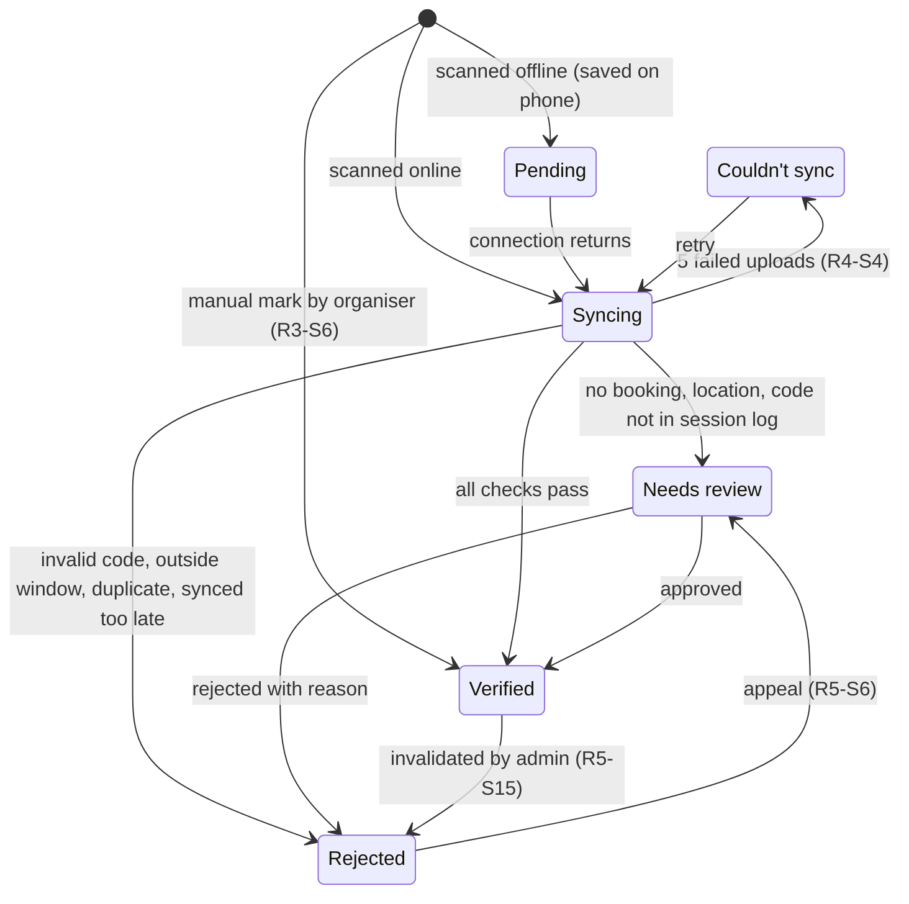

# Research: Requirements Analysis

This file holds the user stories for all three actors (Student, Club Organiser, s-CPD Administrator), covering R1–R6.

**Priority:** **Must** = must-have, built in Part 2. **Nice** = nice-to-have, built if time allows.
**Tags:** ⚠ exceptional case · 🛡 cheating attempt

**Assumptions**
- The s-CPD administrator works in a separate admin tool (R6-S21), not in the student app. Every admin action is written to the audit log (R6-S20).
- Points per event: 1–10.
- Check-in window: from the event start time to 15 min after the event ends (R4-S15).
- Check-in code: the QR code changes every 15 s, and the current and previous codes are accepted, so each code is valid for up to 30 s. The fallback is a 6-digit code that follows the same rules (R4-S23).
- Booking cut-off: 2 h before the start.

## R1: Event Approval

**Design decisions:**
- Event lifecycle: **Draft → Pending → Approved / Rejected**. An approved event can be **Cancelled**, and a pending one **Expires** if it is not reviewed in time.
- Clubs **cannot edit** after submission. The backend enforces this, so booked students can rely on what they saw. To make a change, the club cancels and resubmits.
- The s-CPD administrator decides in the admin tool (R6-S21), with a target of 5 working days after submission.

### R1-S1 · Create an event draft · Must
**User Story:** As a club organiser, I want to create an event so that I can request s-CPD points.
**Acceptance Criteria:**
- Given valid details (title, venue, times, capacity ≥ 1, points 1–10), the event saves as **Draft**.
- Invalid fields are highlighted, and the draft can't be saved until they're fixed.

### R1-S2 · Submit for approval · Must
**User Story:** As a club organiser, I want to submit a draft so that the s-CPD office can review it.
**Acceptance Criteria:**
- The status becomes **Pending**, all fields lock, and the event enters the admin tool's review queue.
- Submitting requires a connection.

### R1-S3 · Track approval status · Must
**User Story:** As a club organiser, I want to track my events' status so that I can plan publicity.
**Acceptance Criteria:**
- Each event shows its status, and a push notification is sent when a decision is made.
- A rejected event shows the administrator's reason.
- If notifications are off or fail, the decision appears in the in-app Notifications list (R5-S17).

### R1-S4 · Approve an event · Must
**User Story:** As an s-CPD administrator, I want to approve an event and confirm its points in the admin tool so that it is published.
**Acceptance Criteria:**
- Given a Pending event, when I approve it in the admin tool (R6-S21) with the event ID, the confirmed points (1 up to the requested value) and an optional note:
    - its status becomes **Approved**;
    - it appears in the Marketplace;
    - its check-in secret is generated (R3-S1).
- The decision is written to the audit log with my name, the old and new status, the reason and the time (R6-S20).
- Each Pending event shows a due date 5 working days after submission, and overdue events are listed first.
- Approval requests from non-administrator accounts are denied (R6-S9).

### R1-S5 · Reject an event · Must
**User Story:** As an s-CPD administrator, I want to reject an event with a reason so that the club can correct it.
**Acceptance Criteria:**
- A rejection in the admin tool cannot be saved without a reason. It is audit-logged like an approval (R6-S20).
- The rejected event can never be listed or booked, and the club is notified (R1-S3).

### R1-S6 · ⚠ Editing locked after submission · Must
**User Story:** As a club organiser, I want to know a submitted event is locked so that I know how to handle changes.
**Acceptance Criteria:**
- Pending and Approved events show no Edit button.
- A notice explains how to cancel and resubmit.

### R1-S7 · 🛡 Bypassing approval · Must
**User Story:** As the system, I want changes outside the workflow rejected so that clubs can't self-approve or inflate points.
**Acceptance Criteria:**
- Security rules deny club writes to status, points, time or capacity after submission, including writes from a modified app or a direct API call.
- Automated rule tests verify this.

### R1-S8 · ⚠ Pending event never reviewed · Must
**User Story:** As a club organiser, I want to know if my event wasn't reviewed in time so that I don't advertise it.
**Acceptance Criteria:**
- An event still Pending at its start time becomes **Expired**, leaves the admin tool's queue, and the club is notified.

### R1-S9 · Cancel an approved event · Nice
**User Story:** As a club organiser, I want to cancel an event so that students aren't left waiting.
**Acceptance Criteria:**
- A reason is required.
- The event leaves the Marketplace, and booked students are notified.
- No points are awarded (R5-S8).

### R1-S10 · ⚠ Drafts kept offline · Nice
**User Story:** As a club organiser, I want drafts saved offline so that I don't lose work.
**Acceptance Criteria:**
- The draft is stored locally, marked *"Not uploaded"*, and uploads when online.

### R1-S11 · Reuse a rejected event · Nice
**User Story:** As a club organiser, I want to copy a rejected event so that I can fix it without retyping.
**Acceptance Criteria:**
- A new Draft is created with the same details, and the original is kept.

---

## R2: Marketplace and Booking

**Design decisions:**
- **Finding events:** search, filters and a "For you" row.
- **Full events:** students can join a waitlist that moves automatically.
- **Clashes:** blocked, with an option to swap one booking for the other.
- **Fairness:** bookings run as server transactions, so capacity is never exceeded.

### R2-S1 · Browse events · Must
**User Story:** As a student, I want to browse upcoming events so that I can find ways to earn points.
**Acceptance Criteria:**
- Only Approved, not-yet-started events are shown, soonest first.
- Each card shows the club, time, venue, points and places left.
- The list has loading, empty and error-with-retry states.

### R2-S2 · Search and filter · Must
**User Story:** As a student, I want to search and filter so that I find relevant events quickly.
**Acceptance Criteria:**
- Keyword search can be combined with filters for category, date, points, club and availability.
- If no results match, the app suggests clearing filters.

### R2-S3 · View event details · Must
**User Story:** As a student, I want full event details so that I can decide whether to attend.
**Acceptance Criteria:**
- The main button reflects my state: **Book**, **Booked ✓**, **Join waitlist**, **Clashes with [event]** or **Booking closed**.

### R2-S4 · Book a place · Must
**User Story:** As a student, I want to book in one tap so that my place is guaranteed.
**Acceptance Criteria:**
- A server transaction reserves exactly one place, and a confirmation is shown.
- The booking is cached for offline use (R4-S10).
- Each student can make only one booking per event.
- Booking closes 2 h before the start.

### R2-S5 · ⚠ Event full · Must
**User Story:** As a student, I want a waitlist for full events so that I can still attend if someone cancels.
**Acceptance Criteria:**
- My waitlist position is shown.
- When someone cancels, the first student in line is booked and notified. If notifications are off, the in-app list is used (R5-S17).
- The waitlist closes at the cut-off.

### R2-S6 · ⚠ Last place taken simultaneously · Must
**User Story:** As a student, I want a fair result if the last place goes while I book so that I'm never wrongly told I have a place.
**Acceptance Criteria:**
- Exactly one booking succeeds.
- The other student sees *"Just filled up"* and is offered the waitlist.

### R2-S7 · ⚠ Booking clash · Must
**User Story:** As a student, I want overlapping bookings flagged so that I don't double-book.
**Acceptance Criteria:**
- I can keep my existing booking or swap it for the new event in one step.
- The server also rejects overlapping bookings.

### R2-S8 · Cancel a booking · Must
**User Story:** As a student, I want to cancel a booking so that my place goes to someone else.
**Acceptance Criteria:**
- Cancelling is allowed until the cut-off, and the waitlist then advances.
- After the cut-off, Cancel is disabled with an explanation.
- The 3-hour reminder's "Can't make it" button follows the same rules and is disabled when offline (R4-S21).

### R2-S9 · ⚠ Browsing offline · Must
**User Story:** As a student without a connection, I want to see saved events so that I can still browse.
**Acceptance Criteria:**
- The cached list is shown with *"Offline: showing saved data"*.
- Booking is disabled while offline.

### R2-S10 · 🛡 Invalid booking via modified app · Must
**User Story:** As the system, I want invalid bookings rejected server-side so that the booking rules can't be bypassed.
**Acceptance Criteria:**
- The server rejects bookings for events that are unapproved, full, past the cut-off or clashing.
- Students can only book for their own account.
- Rule tests cover each case.

### R2-S11 · Recommendations · Nice
**User Story:** As a student, I want suggested events so that I discover relevant activities.
**Acceptance Criteria:**
- A "For you" row ranks events by my interests, my past attendance and categories where I have fewer points.

### R2-S12 · 🛡 Repeated no-shows · Nice
**User Story:** As a club organiser, I want repeated no-shows limited so that places aren't wasted.
**Acceptance Criteria:**
- A booking becomes a **No-show** only after the 72 h sync deadline passes with no check-in record (R4-S26). Records still Needs review never count.
- After 3 no-shows in a semester, a student can hold at most 2 upcoming bookings, with an explanation.
- An approved missing check-in claim removes the no-show (R4-S25).

### R2-S13 · View booking numbers · Nice
**User Story:** As a club organiser, I want to see booking and waitlist counts so that I can prepare the venue.
**Acceptance Criteria:**
- These are visible for my own club's events only (R6-S8).

---

## R3: Secure Attendance

**Design decisions:**
- **Check-in method:** the club's device shows a **QR code that changes every 15 s**. The current and previous codes are accepted, so each code is valid for **up to 30 s**. A **6-digit fallback code** follows the same rules.
    - Each code is signed with a per-event secret that students never receive.
    - The organiser chooses when the code is shown, and each display is recorded in a **session log** (R4-S23).
- **Server checks:**
    - the code's signature and window counter (R4-S16);
    - the student's booking;
    - the registered device (R6-S13, R6-S22);
    - duplicates (R4-S17);
    - for offline records, that the counter appears in the session log (R4-S15).
- **Offline:** check-ins are saved on the phone and sync later (R4-S1).
- **Remaining weakness:** the design blocks remote, late and forged check-ins. It can't prove *who* holds the phone in the room, and it can't confirm *when* an offline scan happened (R3-S7). Proxy check-ins are therefore made harder and auditable rather than impossible.

**Attendance status (used on every screen).** A check-in record always has exactly one of these statuses:

- **How a student checked in** is shown as a separate label: *QR*, *Code* or *Manual*. It is not a status.
- **Booked students with no record** show *Possible no-show until [time]* and then *No-show* (R4-S26). These are booking statuses, not attendance statuses.

### R3-S1 · Start check-in · Must
**User Story:** As a club organiser, I want to display a check-in code so that students check in on arrival.
**Acceptance Criteria:**
- Within the check-in window, tapping **Show code** displays a full-screen rotating QR code with the 6-digit code and a countdown. **Hide code** stops new codes, and both actions are recorded in the session log (R4-S23).
- Outside the window, Show code is disabled.
- Offline operation is covered by R4-S14.

### R3-S2 · Scan to check in · Must
**User Story:** As a student, I want to check in within seconds so that I don't hold up the queue.
**Acceptance Criteria:**
- A booked event shows a **Check in** button during the window.
- The result appears within 2 s (R3 NFR1). Online, it shows **Verified**. Offline, it shows **Pending** with *"Saved on this phone, waiting to sync"* (R4-S1).

### R3-S3 · ⚠ Typing the code · Must
**User Story:** As a student whose camera can't scan, I want to type the code so that I can still check in.
**Acceptance Criteria:**
- The typed 6-digit code is validated exactly like a scan.
- After 5 wrong codes, entry locks for 60 s (R4-S6).
- This is also how check-in is tested on the emulator.

### R3-S4 · ⚠ Clear failure reasons · Must
**User Story:** As a student, I want to know why check-in failed so that I can fix it.
**Acceptance Criteria:**
- The app shows a specific message: *not open*, *closed*, *code expired*, *wrong event*, *already checked in*, or *no booking – sent for review*. Wording follows R4-S6.
- Each message suggests a next step.

### R3-S5 · Live attendance list · Must
**User Story:** As a club organiser, I want live attendance so that I can spot problems during the event.
**Acceptance Criteria:**
- A count is shown (e.g. **42 / 60 Verified**), together with the number of scans for each code display (R4-S23).
- Each attendee shows one status from the attendance status diagram above, plus the QR, Code or Manual label. Booked students with no record show *Not checked in*.

### R3-S6 · Mark present manually · Must
**User Story:** As a club organiser, I want to mark a student present when their phone fails so that genuine attendees aren't penalised.
**Acceptance Criteria:**
- This works only for booked attendees and only within the window.
- A reason is required. The record becomes **Verified** with the **Manual** label.
- My identity, the reason and the time are written to the audit log (R6-S20).

### R3-S7 · 🛡 Screenshot sent to an absent friend · Must
**User Story:** As the system, I want copied codes to expire quickly so that nobody checks in from home.
**Acceptance Criteria:**
- **Online scan:** the code is accepted only if its counter is the current or previous one at server time (valid for up to 30 s).
- **Offline scan:** the server cannot know when the scan happened, so the counter must be inside the check-in window and appear in the club device's session log. Otherwise the record becomes **Needs review**, with the reason *"Code not in session log"* (R4-S15).
- **Known weakness:** a live code forwarded to an absent student and scanned offline passes both checks. It is caught only by the location flag (R3-S12), or when the organiser sees more scans for a display than people in the room (R3-S5). This is listed in the security analysis.

### R3-S8 · 🛡 Checking in outside the event time · Must
**User Story:** As the system, I want check-ins outside the window rejected so that attendance can't be claimed afterwards.
**Acceptance Criteria:**
- The check-in window runs from the event start time to 15 min after the event ends. A counter outside it is rejected.
- The signed window counter is used, not the phone clock, so changing the device time has no effect (R4-S16).
- Offline records must also sync within 72 h of the event ending (R4-S5).

### R3-S9 · 🛡 Forged code · Must
**User Story:** As the system, I want fake codes rejected so that check-ins can't be generated remotely.
**Acceptance Criteria:**
- Codes with an invalid signature are rejected and logged.
- The secret is readable only by the owning club (R6-S7, R6-S8) and expires after the window.

### R3-S10 · 🛡 Checking in for a friend · Must
**User Story:** As the system, I want each check-in tied to one student and one registered device so that nobody checks in others.
**Acceptance Criteria:**
- Each device can make one check-in per event.
- Records must be signed by the student's registered key (R6-S13, R6-S22).
- Fingerprint or PIN confirmation is used when enabled (R4-S12).
- **Weakness:** someone carrying a friend's own unlocked phone.

### R3-S11 · 🛡 Check-in without a booking · Must
**User Story:** As the system, I want unbooked check-ins held for review so that walk-ins can't claim points automatically.
**Acceptance Criteria:**
- The record becomes **Needs review** with the reason *"No booking"*, and the organiser decides (R4-S7, R4-S18).
- No points are given until it's approved (R5-S3).

### R3-S12 · 🛡 Faked location · Nice
**User Story:** As the system, I want suspicious locations flagged so that spoofing is visible.
**Acceptance Criteria:**
- A mock location, or a position more than 200 m from the venue, marks the record **Needs review**.
- A missing location never blocks check-in, since indoor GPS is unreliable (R4-S15).

### R3-S13 · 🛡 Club marking absent friends present · Nice
**User Story:** As an s-CPD administrator, I want manual check-ins audited so that clubs can't credit absent friends.
**Acceptance Criteria:**
- Events where more than 20% of attendance is Manual are flagged in the admin tool (R6-S21).
- The administrator decides within 5 working days.

### R3-S14 · Check-out · Nice
**User Story:** As a club organiser, I want attendees to also check out so that points go only to those who stayed.
**Acceptance Criteria:**
- When this is enabled, attendance is Verified only if both scans are valid.
- Without check-out, organisers can show the code several times during the event instead (R4-S23).

---

# R4: Online and Offline

## R4 S1 - Offline check-in
**Priority:** Must have

**User story:** As a student, I want to check in at an event even when I have no signal, so that I still get credit for attending.

**Acceptance criteria**

- AC1: Given I have no internet connection and I am booked on the event, When I scan the valid event code during the event, Then my check-in is saved and signed on my phone within 1 second and I see "Saved on this phone, waiting to sync" with the time I scanned.
- AC2: Given I have no internet connection, When I scan a valid code, Then the app does not show any network error or ask me to try again later.

**Exception cases**

- EX1: Given I have already checked in to this event on this phone, When I scan the code again, Then I see "You have already checked in" and no second record is saved.
- EX2: Given I have no booking and the event is not full, When I scan the code, Then the check-in is saved with the status Needs review and the reason "No booking".
- EX3: Given my phone storage is full, When I scan, Then the behaviour in R4 S24 applies.
- EX4: Given the app has never been opened online on this phone or this phone is not registered, When I scan, Then I see "Connect to the internet once to set up check-in" and nothing is saved.

## R4 S2 - Automatic sync
**Priority:** Must have

**User story:** As a student, I want my saved check-ins to upload automatically when I get a connection, so that I do not have to remember to sync them myself.

**Acceptance criteria**

- AC1: Given I have check-ins waiting to sync, When my phone gets a connection again, Then the upload starts within 60 seconds without me opening any screen.
- AC2: Given I closed the app or restarted my phone before syncing, When I get a connection, Then my waiting check-ins are still there and are uploaded.
- AC3: Given a check-in was uploaded successfully, When the app retries or syncs again, Then it is not uploaded a second time.

**Exception cases**

- EX1: Given the upload is interrupted halfway (connection lost), When the connection returns, Then the upload resumes and no check-in is duplicated or lost.
- EX2: Given the phone has a connection but the server cannot be reached, When the upload fails, Then the app retries with the delays in R4 S4 EX1 and the check-in stays Pending.
- EX3: Given battery saver or background restrictions stop the background upload, When I next open the app online, Then the upload starts within 10 seconds of opening.
- EX4: Given my session has expired, When the upload is attempted, Then R4 S11 applies.

## R4 S3 - Sync status visibility
**Priority:** Must have

**User story:** As a student, I want to see which of my check-ins have synced, so that I know my attendance will count.

**Acceptance criteria**

- AC1: Given I have check-ins in different states, When I open "My attendance", Then each one shows exactly one status from the list at the top of R4: Pending, Syncing, Verified, Rejected, Needs review or Couldn't sync.
- AC2: Given at least one check-in is waiting, When I use the app, Then a banner shows how many are waiting, for example "2 check-ins waiting to sync".
- AC3: Given I am online with waiting check-ins, When I tap "Sync now", Then the upload starts immediately and the "Last synced" time updates.

**Exception cases**

- EX1: Given I am offline, When I tap "Sync now", Then I see "You are offline. Your check-ins are safe on this phone" and nothing changes.
- EX2: Given a sync is already running, When I tap "Sync now", Then no second sync starts.
- EX3: Given I have more than 20 check-ins, When I open "My attendance", Then they load in pages of 20, newest first, and the banner count is still correct.

## R4 S4 - Failed sync handling
**Priority:** Must have

**User story:** As a student, I want to see a clear message when a check-in cannot be synced, so that I know what to do and do not wait forever.

**Acceptance criteria**

- AC1: Given the upload fails 5 times in a row, When I open "My attendance", Then the check-in shows "Couldn't sync", the reason, and a "Retry" button instead of staying on "Syncing".
- AC2: Given a check-in is Rejected, When I tap it, Then I see the reason in plain language, for example "Code expired" or "Synced too late", and an "Appeal" button. Appeals are decided by the s-CPD admin.

**Exception cases**

- EX1: Given an upload fails, When the app retries, Then the first 5 attempts wait 30 seconds, 1, 2, 4 and 8 minutes (backoff base 30 seconds, doubling), and after that the app retries at most once every 6 hours until the 72-hour deadline (assumed).
- EX2: Given a check-in is in "Couldn't sync" and less than 12 hours remain before the 72-hour deadline, When I open the app, Then a warning shows the time left.
- EX3: Given the failure keeps happening after I tap "Retry", When I tap "Report a problem", Then a support message with the check-in ID (no personal data) is prepared so I can send it to the s-CPD office.
- EX4: Given the failure reason is a server error and not a rejection, When the server recovers, Then the check-in is uploaded without any action from me and without being marked Rejected.

## R4 S5 - Late sync of an on-time scan
**Priority:** Must have

**User story:** As a student, I want a check-in I made during the event to count even if my phone only synced later, so that a weak signal does not cost me my points.

**Acceptance criteria**

- AC1: Given I scanned during the event and I am offline, When my phone syncs within 72 hours after the event ends, Then the check-in is judged on the time inside the scanned code (not the upload time and not my phone clock), and can become Verified.
- AC2: Given I scanned during the event, When my phone syncs more than 72 hours after the event ends, Then the check-in shows Rejected with the reason "Synced too late" and an option to appeal.

**Exception cases**

- EX1: Given the event was cancelled before my check-in synced, When it syncs, Then it is not Verified and shows "Event cancelled".
- EX2: Given the organiser changed the event time after I scanned, When my check-in syncs, Then it is judged against the event time that was valid when the code was issued.
- EX3: Given my check-in syncs exactly at the 72-hour limit, When the server checks it, Then the server clock decides and the rule is applied the same way every time.

## R4 S6 - Wrong or expired code
**Priority:** Must have

**User story:** As a student, I want to be told right away when I scan a wrong or expired code, so that I can scan again while I am still at the event.

**Acceptance criteria**

- AC1: Given I scan a code that belongs to another event, When the app reads it, Then I see "This code is not valid for this event", nothing is saved, and I can scan again.
- AC2: Given I scan a code older than its 30-second window, When the app reads it, Then I see "Code expired, please scan the current code" and nothing is saved.
- AC3: Given my camera does not work or permission is denied, When I tap "Enter code manually", Then I can type the 6-digit code shown by the club and check in the same way.

**Exception cases**

- EX1: Given I scan something that is not an event code (for example a website QR), When the app reads it, Then I see "This is not an event code" and nothing is saved.
- EX2: Given I type a manual code with the wrong number of digits or non-digits, When I tap "Check in", Then I see a field error and nothing is saved.
- EX3: Given I enter a wrong manual code 5 times, When I try again, Then manual entry is locked for 60 seconds (assumed) to stop guessing.
- EX4: Given camera permission is denied, When I open the scanner, Then I see a button to open settings as well as "Enter code manually".
- EX5: Given I am booked on two back-to-back events, When I scan a code of the other event, Then AC1 applies.

## R4 S7 - Check-in without a booking
**Priority:** Must have

**User story:** As a student who could not book because the event was full, I want my attendance to be recorded for the club to review, so that I can still be considered for points if the club lets me in.

**Acceptance criteria**

- AC1: Given the event is full and I have no booking, When I scan the code at the event, Then my check-in is saved with the status Needs review and the reason "No booking", and I am told the club decides whether points are given.
- AC2: Given I have no booking, When the club approves my record, Then my status changes to Verified and the normal points rules apply.
- AC3: Given I have no booking, When the club rejects my record, Then my status changes to Rejected with the reason "Rejected by club" and I can still read the reason.

**Exception cases**

- EX1: Given the club does not decide within 7 days of the event (assumed), When the period ends, Then the record stays Needs review and the s-CPD admin list shows it as overdue. It is never auto-approved.
- EX2: Given a booking is cancelled by me before the event, When I scan at the event, Then this story applies as if I had no booking.
- EX3: Given I am on a waiting list that later gets a place, When the place is confirmed after my scan, Then my record is re-checked and can become Verified without club action.
- EX4: Given the club rejected my record, When I tap "Appeal", Then the appeal goes to the s-CPD admin and not to the club (R5 S6).

## R4 S8 - Log out with unsynced check-ins
**Priority:** Must have

**User story:** As a student, I want a warning before I log out with unsynced check-ins, so that I do not lose my attendance by accident.

**Acceptance criteria**

- AC1: Given I have check-ins waiting to sync, When I tap "Log out", Then I see "You have 2 check-ins not synced yet" with the options "Sync now" and "Cancel".
- AC2: Given I am offline with waiting check-ins when I try to log out, Then I am told to reconnect first and my check-ins are not deleted.

**Exception cases**

- EX1: Given I choose "Sync now" and the sync fails, When the failure is shown, Then I stay logged in and no data is deleted.
- EX2: Given my session expired while check-ins are waiting, When I log out, Then the check-ins are kept on the phone and uploaded after I next log in with the same account (see R4 S11).
- EX3: Given an administrator disables my account, When I have unsynced check-ins, Then I am signed out but the records are kept until the account is re-enabled or 72 hours pass after the event, and the s-CPD office can review them.
- EX4: Given I log in with a different account on the same phone while records of the first account are waiting, When I log in, Then the first account's records are not visible, not uploaded under the new account and not deleted.

## R4 S9 - Safe save if app closes
**Priority:** Must have

**User story:** As a student, I want a check-in to be either safely saved or clearly not saved if my app closes or my battery dies while scanning, so that I never think I checked in when I did not.

**Acceptance criteria**

- AC1: Given I have just scanned, When the app closes at any point, Then on reopening I see either the saved check-in in "My attendance" or no record and a prompt to scan again.

**Exception cases**

- EX1: Given the phone loses power while the record is being written, When it restarts, Then no half-written record exists (the save is all-or-nothing).
- EX2: Given the "Saved on this phone" message was shown, When the phone then loses power, Then the record is still present after restart.
- EX3: Given a check-in record cannot be read after a crash (corrupted), When I open the app, Then I see "One check-in could not be recovered, please scan again or contact the club" and the rest of the records are unaffected.

## R4 S10 - View bookings offline
**Priority:** Nice to have

**User story:** As a student, I want to see my booked events and ticket details offline, so that I can find the venue and show my booking without signal.

**Acceptance criteria**

- AC1: Given I have booked events and I have opened the app online before, When I open "My events" without a connection, Then my bookings, venue and times are shown with the notice "Offline: showing saved data".

**Exception cases**

- EX1: Given I have never loaded my bookings on this phone, When I open "My events" offline, Then I see "Connect to the internet to load your events".
- EX2: Given the saved data is more than 24 hours old, When it is shown, Then the notice also shows the "Last updated" time and a warning that the event may have changed.
- EX3: Given I cancelled or the club cancelled an event while I was offline, When I reconnect, Then the list updates and I am notified of the change.

## R4 S11 - Expired session while offline
**Priority:** Nice to have

**User story:** As a student, I want to stay able to check in if my login expires while I am offline, so that a timeout does not stop me at the event.

**Acceptance criteria**

- AC1: Given my login session expired while I am offline, When I scan a valid code, Then the check-in is saved on my phone as normal.
- AC2: Given I have saved check-ins and an expired session, When I get a connection, Then I am asked to log in again and my check-ins upload after I do.

**Exception cases**

- EX1: Given I log in again with a different account than the one that scanned, When the upload would start, Then the records are not uploaded and I am told they belong to another account.
- EX2: Given my account was disabled while I was offline, When I try to log in, Then I cannot log in and the check-ins stay on the phone for review by the s-CPD office (see R4 S8 EX3).
- EX3: Given the session has been expired for more than 30 days (assumed), When I scan offline, Then the scan is still saved but the record is marked Needs review when uploaded.

## R4 S12 - Biometric confirmation
**Priority:** Nice to have

**User story:** As a student, I want to confirm my check-in with my fingerprint or PIN, so that nobody else can check in using my unlocked phone.

**Acceptance criteria**

- AC1: Given biometric confirmation is turned on, When I scan a valid code, Then the phone asks for my fingerprint or PIN before the check-in is saved.
- AC2: Given the biometric prompt appears, When I cancel it, Then nothing is saved and I can scan again.

**Exception cases**

- EX1: Given my phone has no fingerprint or screen lock set up, When I try to turn the feature on, Then I am told to set up a screen lock first and the feature stays off.
- EX2: Given I fail the fingerprint 3 times, When the phone offers PIN, Then I can use the phone PIN as the fallback.
- EX3: Given the code expires while the biometric prompt is open, When I confirm, Then I see "Code expired, please scan again" and nothing is saved.

## R4 S13 - Move to a new phone
**Priority:** Nice to have

**User story:** As a student who has got a new phone, I want to move my account to it, so that I can keep checking in without losing earlier records.

**Acceptance criteria**

- AC1: Given I log in on a new phone, When I confirm the change on the new phone, Then the new phone is registered (R6 S22) and the old phone can no longer check in.
- AC2: Given check-ins are still waiting on the old phone, When the change is made, Then I am warned that unsynced check-ins on the old phone must be synced first.

**Exception cases**

- EX1: Given my old phone is lost, broken or cannot go online, When I ask the s-CPD office to release the old phone, Then an admin can unregister it in the admin tool (R6 S21) and the action is written to the audit log (R6 S20).
- EX2: Given I changed phones in the last 7 days (assumed), When I try to change again, Then I am told to contact the s-CPD office.
- EX3: Given unsynced records are lost with the old phone, When I report this, Then the "Missing check-in claim" in R4 S25 applies.

## R4 S14 - Organiser runs check-in offline
**Priority:** Must have

**User story:** As a club organiser, I want to run check-in without a connection, so that a weak venue signal does not stop my event.

**Acceptance criteria**

- AC1: Given I opened the event online before it started, When the venue has no internet, Then the changing QR code and the 6-digit manual code keep working.
- AC2: Given I have not opened the event online beforehand, When I try to start check-in, Then I see a warning that the event must be loaded while online first.

**Exception cases**

- EX1: Given my phone battery dies or the app is closed during the event, When I reopen the event, Then code display can be resumed and codes issued earlier stay valid for scans already made.
- EX2: Given I am offline for the whole event, When I reconnect, Then the session log of codes shown during the event (each code counter with its time) is uploaded so the server can verify student scans (see R4 S15 AC4 and R4 S23).
- EX3: Given the event details were loaded more than 24 hours before the event, When I start check-in online, Then the app refreshes the event data first.

## R4 S15 - Reject check-ins from people not at the event
**Priority:** Must have

**User story:** As a club organiser, I want check-ins from people who were not at my event to be rejected, so that my attendance list can be trusted.

**Acceptance criteria**

- AC1: Given a student sends a photo of an old code, When the code is older than its 30-second window, Then the check-in is rejected.
- AC2: Given a student scans after the event has ended plus the 15-minute grace period, When the record reaches the server, Then it is rejected as "outside event time".
- AC3: Given a student's location is far from the venue, When the record reaches the server, Then it is marked Needs review and not rejected automatically.
- AC4: Given an offline record whose code counter does not appear in the club device's session log, When the record reaches the server, Then it is marked Needs review with the reason "Code not in session log".

**Exception cases**

- EX1: Given the student's location permission is denied or the location is missing, When the record reaches the server, Then location is not used as a reason to reject and the check-in is judged on the code only.
- EX2: Given the venue location is not set for the event, When the record is checked, Then no location check is made.
- EX3: Given a student shares a live screenshot of the current code with a friend who is not present, When the friend scans it offline, Then the code counter is in the session log so AC4 does not catch it, but the location rule in AC3 can flag it and the organiser can review it. This is a known weakness and must be listed in the security analysis.
- EX4: Given the club device's session log has not been uploaded yet, When records arrive, Then they stay Needs review with the reason "Waiting for session log" and are checked again when the log arrives (up to 72 hours).

## R4 S16 - Phone clock cannot be used to cheat
**Priority:** Must have

**User story:** As a club organiser, I want a check-in to depend on my event's code and not on the student's phone clock, so that changing the date on a phone does not help anyone cheat.

**Acceptance criteria**

- AC1: Given a student changes their phone time to a time inside the event, When the code window in the record falls outside the event time, Then the check-in is rejected.
- AC2: Given a student's phone clock is wrong but the code window is inside the event time, When the record reaches the server, Then the check-in is judged only on the code window and is not rejected because of the phone clock.

**Exception cases**

- EX1: Given the phone time and the code window differ by more than 24 hours (assumed), When the record reaches the server, Then it is marked Needs review and counted towards the flagging rule in R4 S20.

## R4 S17 - Copied or edited check-ins
**Priority:** Must have

**User story:** As a club organiser, I want copied or edited check-ins to be rejected, so that nobody can inflate attendance for my event.

**Acceptance criteria**

- AC1: Given a check-in was already accepted, When the same check-in is sent again, Then no second record is created.
- AC2: Given someone edits the saved check-in on their phone, When it is uploaded, Then the signature does not match and it is rejected and the account is flagged for review.
- AC3: Given a student tries to check in a second time for the same event, When the record reaches the server, Then it is rejected as a duplicate.
- AC4: Given a check-in is saved offline, When it is saved, Then it is signed with a key kept in the Android Keystore of the registered phone (R6 S22), and the server checks the signature before accepting it.

**Exception cases**

- EX1: Given the first upload succeeded but the phone never received the reply, When the phone sends the same check-in again, Then the server returns the original result and the student sees Verified or Pending, not Rejected as a duplicate.
- EX2: Given a student checked in on two different phones, When both records arrive, Then the one from the unregistered phone is rejected.
- EX3: Given the signing key can no longer be used (for example the phone was reset or its screen lock changed), When records signed before that arrive, Then they are marked Needs review and not Rejected.

## R4 S18 - Organiser review of Needs review records
**Priority:** Must have

**User story:** As a club organiser, I want to review check-ins that need a decision, so that honest students are not unfairly excluded.

**Acceptance criteria**

- AC1: Given some records are marked Needs review for reasons the club can judge (no booking, location, code not in session log, missing check-in claim), When I open the event's attendance list, Then I can see each student, the reason it needs review, and "Approve" and "Reject" buttons.
- AC2: Given I approve or reject a record, When I confirm, Then the decision is saved with my name and the time.

**Exception cases**

- EX1: Given two organisers act on the same record, When the second one confirms, Then they see "Already decided by [name]" and the first decision stays.
- EX2: Given I am offline, When I try to approve or reject, Then I am told a connection is needed (decisions are never saved only on the organiser's phone).
- EX3: Given I reject a record, When I confirm, Then a reason is required so the student can read it (R4 S7 AC3).
- EX4: Given a record belongs to a student of a different club's event, When I try to open it, Then it is denied.
- EX5: Given a record is Needs review because of an appeal, a tampering flag or a phone-clock mismatch, When I open the list, Then I cannot decide it and it shows "With s-CPD admin".

## R4 S19 - Organiser phone clock wrong
**Priority:** Nice to have

**User story:** As a club organiser, I want the app to cope with my phone's clock being wrong, so that valid check-ins are not rejected by mistake.

**Acceptance criteria**

- AC1: Given my phone clock is a few minutes wrong (up to 5 minutes), When students' check-ins are verified, Then the difference is tolerated.
- AC2: Given my phone clock is more than 5 minutes wrong, When I start check-in while online, Then I am warned to fix it.

**Exception cases**

- EX1: Given my phone is offline and the clock is wrong by more than 5 minutes, When I show codes, Then codes are still issued using the last known server time offset, and the records are marked Needs review if the offset is uncertain.

## R4 S20 - Flag suspicious accounts
**Priority:** Nice to have

**User story:** As an s-CPD admin, I want accounts with repeated rejected or tampered check-ins to be flagged in the backend, so that I can investigate misuse.

**Acceptance criteria**

- AC1: Given an account has 3 or more rejected check-ins for tampering or duplicates, When I look at the backend data, Then the account appears in a flagged list with the reasons.
- AC2: Given an account is flagged, When it appears in the list, Then the s-CPD admin (not a club) reviews it and decides within 5 working days.

**Exception cases**

- EX1: Given a flagged account is cleared by an admin, When the admin saves, Then the clearance is saved with the admin name, reason and time in the audit log.
- EX2: Given the student is flagged, When a flag is raised, Then the student's access is not blocked automatically (an admin decides).

## R4 S21 - "Can't make it" only when online and before the cut-off
**Priority:** Must have

**User story:** As a student, I want the "Can't make it" button on the 3-hour reminder to work when I can really cancel and to tell me clearly when I cannot, so that I do not think a booking was cancelled when it was not.

**Acceptance criteria**

- AC1: Given I am online and more than 2 hours remain before the event (the cut-off in R2-S8), When I tap "Can't make it" on the 3-hour reminder, Then my booking is cancelled at once and the place is released.
- AC2: Given I am offline, When I open the 3-hour reminder, Then "Can't make it" is disabled and shows "You are offline. Connect to the internet to cancel". Nothing is saved or queued, because the place cannot be released offline.
- AC3: Given less than 2 hours remain before the event, When I open the 3-hour reminder, Then "Can't make it" is disabled and shows "Cancellation closed 2 hours before the event".

**Exception cases**

- EX1: Given the button was disabled because I was offline and I get a connection before the cut-off, When the connection returns, Then the button becomes enabled without me reopening the reminder.
- EX2: Given I tap the button just before the cut-off but the request reaches the server after it, When the server checks the time, Then the cancellation is refused with "Too late to cancel" and the booking stays.
- EX3: Given I tap the button twice, When the server receives both, Then only one cancellation is made.
- EX4: Given I cancel and the event is full, When the place is released, Then the first student on the waiting list is offered it.

## R4 S22 - Back-to-back events
**Priority:** Must have

**User story:** As a student booked on two events that run one after the other, I want each scan to count only for the event whose code I scanned, so that I get fair credit for both.

**Acceptance criteria**

- AC1: Given I am booked on event A (ends 14:00) and event B (starts 14:00), When I scan event B's code at 14:05, Then the record is saved for event B only.
- AC2: Given the 15-minute grace period of event A overlaps the start of event B, When I scan event A's code at 14:10, Then it can count for A, but it does not count for B.
- AC3: Given I want credit for both events, When I scan both codes, Then two separate records are created, one per event.

**Exception cases**

- EX1: Given two events overlap in time and I am booked on both, When I try to book the second, Then I see "This overlaps with another event you booked" and can still choose to continue; both bookings are allowed but a warning is stored.
- EX2: Given I scan only one of two overlapping events' codes, When the records sync, Then the other event gets no attendance record.
- EX3: Given one scan is made within the overlap of two events and the code is valid for both, When the record is made, Then the code's own event ID decides which event it counts for.

## R4 S23 - Organiser decides when codes are shown
**Priority:** Must have

**User story:** As a club organiser, I want to choose when the check-in code is shown during the event, so that students cannot just scan at the start or end and leave.

**Acceptance criteria**

- AC1: Given check-in is open for my event, When I tap "Show code", Then the changing QR code and 6-digit code are displayed, the code changes every 15 seconds and the current and previous code are accepted (up to 30 seconds).
- AC2: Given the code is displayed, When I tap "Hide code", Then no new code is issued and scans of hidden codes after 30 seconds are rejected as expired.
- AC3: Given I show the code several times during the event, When students scan, Then every code display is logged with start time, end time and the code counters shown (the session log used in R4 S15 AC4).
- AC4: Given I show the code at least once, When I open the attendance list, Then I see how many students scanned in each display.

**Exception cases**

- EX1: Given I have never shown a code during the event, When the event ends, Then I am warned "No code was shown, nobody could check in".
- EX2: Given a code is shown before the event start time or after the 15-minute grace period, When a student scans it, Then it is rejected as "outside event time" (R4 S15).
- EX3: Given the s-CPD admin requires at least 2 code displays per event, When the organiser shows only one, Then the event can still be saved but is flagged for admin review (assumed rule, to confirm with MDP partners).

## R4 S24 - Phone storage full
**Priority:** Must have

**User story:** As a student, I want to be warned when my phone is almost full and told clearly if a check-in cannot be saved, so that I do not believe I checked in when I did not.

**Acceptance criteria**

- AC1: Given my free phone storage is under 50 MB, When I open the app, Then a warning tells me to free up space before the event.
- AC2: Given my storage is full, When I scan a valid code, Then I see "Not saved: your phone storage is full. Free up space and scan again" and no record is created.

**Exception cases**

- EX1: Given my storage becomes full while the record is being written, When the write fails, Then no half-written record remains.
- EX2: Given the app has check-ins waiting and storage becomes full, When I free up space, Then the waiting records are not lost.
- EX3: Given the app cache is full of other data, When a check-in is saved, Then the cache is cleared first and the check-in records are never deleted automatically.

## R4 S25 - App uninstalled or data lost
**Priority:** Must have

**User story:** As a student, I want to know what happens to my waiting check-ins if I uninstall the app or lose my phone, and to have a way to claim my missing attendance, so that I am not left with no help.

**Acceptance criteria**

- AC1: Given I have check-ins waiting to sync, When I open the app, Then the banner says "Uninstalling or clearing app data will delete check-ins that are not synced".
- AC2: Given I reinstalled the app or changed phone and my earlier check-ins were never synced, When I submit a "Missing check-in claim" for the event within 7 days, Then the claim is saved with the status Needs review and the reason "Missing check-in claim", and the organiser decides.
- AC3: Given I submit a claim, When the organiser approves, Then it becomes Verified under the normal points rules and the decision is written to the audit log.

**Exception cases**

- EX1: Given I have no booking for the event and I submit a claim, When the claim reaches the organiser, Then it also shows "no booking".
- EX2: Given the claim window has passed, When I try to submit a claim, Then I am told to contact the s-CPD office.
- EX3: Given I submit more than 5 claims in one month, When I submit another, Then the account is flagged for review (R4 S20).
- EX4: Given I log in again after reinstalling, When the app opens, Then my already-synced attendance and points are shown again from the server.
- EX5: Given the organiser rejects my claim, When I tap "Appeal", Then the appeal goes to the s-CPD admin (R5 S6).

## R4 S26 - No-show only after the sync deadline
**Priority:** Must have

**User story:** As a student who attended an event, I want to be marked as a no-show only after my offline check-in has had time to sync, so that I am not penalised unfairly.

**Acceptance criteria**

- AC1: Given I booked an event and I have no check-in record, When the event ends, Then my booking shows "Waiting for sync period" and not "No-show".
- AC2: Given 72 hours have passed since the event ended and I still have no check-in record, When the server runs its check, Then my booking is marked "No-show" and any no-show rule in R2-S12 is applied.
- AC3: Given my check-in syncs within the 72 hours, When it is accepted or sent to review, Then I am never marked as a no-show for that event.

**Exception cases**

- EX1: Given my record is Needs review when the 72 hours end, When the server runs its check, Then I am not marked as a no-show until a decision is made.
- EX2: Given the organiser opens the attendance list before the 72 hours end, When students have no record, Then they show "Possible no-show until [time]".
- EX3: Given I was marked as a no-show and my missing check-in claim (R4 S25) is later approved, When it is approved, Then the no-show mark is removed and the change is logged.

# R5: Points and Progress

## R5 S1 - Total points on home screen
**Priority:** Must have

**User story:** As a student, I want to see my total s-CPD points on my home screen, so that I know how far I have got.

**Acceptance criteria**

- AC1: Given I have earned points, When I open the app, Then my total is shown and matches the sum of my credited entries minus my reversed entries.
- AC2: Given I have earned no points yet, When I open the app, Then I see 0 and a short message explaining how to earn points.

**Exception cases**

- EX1: Given the total cannot be loaded and I have no saved value, When I open the app, Then I see "Could not load your points. Try again" with a retry button, not a 0.
- EX2: Given my total is shown from saved data, When I am offline, Then the offline notice in R5 S7 applies.
- EX3: Given I have credited and reversed entries of the same event, When the total is calculated, Then it counts the credit once and the reversal once, so the net for that event is 0.

## R5 S2 - Points history
**Priority:** Must have

**User story:** As a student, I want a history of every points entry, so that I can see where each point came from.

**Acceptance criteria**

- AC1: Given I have points entries, When I open "Points history", Then each entry shows the event, the date, the points and its status (Pending, Credited or Reversed), newest first.

**Exception cases**

- EX1: Given I have no entries, When I open "Points history", Then I see "No points yet" and a link to the Marketplace.
- EX2: Given I have more than 20 entries, When I scroll, Then they load in pages of 20 without duplicates or missing entries.
- EX3: Given the event name was changed after the entry was made, When I view the history, Then the current event name is shown with the original date.

## R5 S3 - When points will be added
**Priority:** Must have

**User story:** As a student, I want to see exactly when my points will be added, so that I am not worried when they do not appear straight away.

**Acceptance criteria**

- AC1: Given I checked in but the event has not ended or my record is not verified yet, When I open my points, Then the points appear as "Pending" with the reason (for example "Waiting for the event to end" or "Waiting for check-in to sync") and are not in my total.
- AC2: Given my record is Verified and the event has ended, When the points are processed, Then they move from Pending to Credited within 1 hour and my total goes up.

**Exception cases**

- EX1: Given my record is Needs review, When I open my points, Then the reason shows "Waiting for club decision" or "Waiting for s-CPD admin decision" and how long it has been waiting.
- EX2: Given my record is still Pending after 7 days, When I open my points, Then I see a button to contact the s-CPD office.
- EX3: Given points processing is delayed, When it has not run within 24 hours, Then the s-CPD admin backend shows a warning.

## R5 S4 - Points only for genuine attendance
**Priority:** Must have

**User story:** As a student, I want points to be given only for people who genuinely attended, so that my points are respected by the university and others.

**Acceptance criteria**

- AC1: Given my record is Verified and the event has ended, When points are processed, Then exactly one credit is created for that event.
- AC2: Given my record is Rejected or I have no record, When points are processed, Then no credit is created.
- AC3: Given points were already credited, When the process runs again, Then I do not receive double points.

**Exception cases**

- EX1: Given points processing runs twice at the same time, When both finish, Then only one credit exists for that student and event.
- EX2: Given an event has a points value of 0, When points are processed, Then no credit entry is created and no notification is sent.
- EX3: Given my record becomes Verified after the event ended, When it is verified, Then points are processed the same way as AC1.

## R5 S5 - Reversal of points
**Priority:** Must have

**User story:** As a student, I want to be told clearly if points are taken away later, so that I am never surprised and can challenge it.

**Acceptance criteria**

- AC1: Given a credited record is later found invalid, When the points are reversed, Then my history shows a "Reversed" entry with the reason and the original credit stays visible.
- AC2: Given points were reversed, When this happens, Then my total goes down by that amount and I receive a notification.
- AC3: Given levels or badges are based on my confirmed points, When a reversal makes my total fall below a level threshold, Then my level is recalculated within 5 seconds, a badge earned only from the reversed event is removed, and I am told which level or badge changed and why.

**Exception cases**

- EX1: Given a credit is reversed twice by mistake, When the second reversal is attempted, Then it is refused and I am not charged twice.
- EX2: Given the event was cancelled after points were credited, When the admin reverses them, Then the reason shows "Event cancelled".
- EX3: Given a reversal happens while I am offline, When I next open the app online, Then my total and history update and a notification is shown.
- EX4: Given a reversal is later undone because my appeal was accepted (R5 S6), When the new credit is made, Then the level and badges are recalculated the same way.

## R5 S6 - Appeals
**Priority:** Nice to have

**User story:** As a student, I want to appeal a rejection or reversal, so that a mistake can be corrected.

**Acceptance criteria**

- AC1: Given a record is Rejected or Reversed, When I tap "Appeal" and send a note (maximum 500 characters), Then the record moves to Needs review and I can see the appeal status.
- AC2: Given I have appealed, When the appeal is reviewed, Then it is decided by the s-CPD admin (never by the club whose decision is appealed) within 5 working days.
- AC3: Given my appeal is accepted, When the decision is made, Then I receive the points as a new credit entry and I am notified.

**Exception cases**

- EX1: Given I send an appeal while offline, When I tap "Send", Then it is saved on the phone and sent when I reconnect, the same way as a check-in.
- EX2: Given 14 days have passed since the decision (assumed), When I tap "Appeal", Then I see "The appeal period has ended" and no appeal is made.
- EX3: Given I already appealed this record, When I try to appeal again, Then I am told only one appeal is allowed and the status is shown.
- EX4: Given my appeal is rejected, When the decision is made, Then I see the reason and the record stays Rejected.
- EX5: Given an appeal has not been decided after 5 working days, When the time passes, Then it shows as overdue at the top of the admin list and I see "Your appeal is taking longer than expected".

## R5 S7 - Points offline
**Priority:** Must have

**User story:** As a student, I want to see my points when I am offline, so that I can check my progress anywhere.

**Acceptance criteria**

- AC1: Given I have opened my points online before, When I open them without a connection, Then I see my last known total and history with "Last updated" and an offline notice.

**Exception cases**

- EX1: Given I have never loaded my points on this phone, When I open them offline, Then I see "Connect to the internet to load your points".
- EX2: Given I log out, When I log in as another student on the same phone, Then the first student's saved points are not shown (R6 S12).
- EX3: Given the saved data is more than 7 days old, When it is shown, Then a warning says it may be out of date.

## R5 S8 - Cancelled event
**Priority:** Must have

**User story:** As a student, I want no points for a cancelled event, so that my total stays correct.

**Acceptance criteria**

- AC1: Given an event I checked in for is cancelled, When points are processed, Then no points are credited and my Pending entry shows "Event cancelled".

**Exception cases**

- EX1: Given the event is cancelled after the credit was made, When the admin acts, Then R5 S5 EX2 applies.
- EX2: Given an event is postponed (new date, not cancelled), When the new date is set, Then my Pending entry and booking move to the new date and the check-in rules use the new time.

## R5 S9 - Points cannot be changed directly
**Priority:** Must have

**User story:** As a student, I want nobody, including me, to be able to change points directly, so that my s-CPD record can be trusted.

**Acceptance criteria**

- AC1: Given I use a modified app or send my own request to change my points, When the request reaches the backend, Then it is denied and my points are unchanged.
- AC2: Given a club organiser tries to add points to a student directly, When the request reaches the backend, Then it is denied.

**Exception cases**

- EX1: Given a denied attempt is made, When it is denied, Then it is written to the audit log with the account and time, and repeated attempts (3 or more) flag the account (R4 S20).
- EX2: Given an s-CPD admin needs to correct points, When the admin acts, Then the correction is made only as a new credit or reversal entry with a reason, never as an edit of an old entry.

## R5 S10 - Progress and categories
**Priority:** Nice to have

**User story:** As a student, I want to see my progress towards a target and by category, so that I know what kinds of activities I still need.

**Acceptance criteria**

- AC1: Given I have credited points, When I open the points screen, Then a progress bar shows my total against the target and a breakdown by category is available.

**Exception cases**

- EX1: Given no target is set for my programme, When I open the points screen, Then no progress bar is shown and the message "No target set" appears.
- EX2: Given my total is above the target, When the bar is shown, Then it is full and shows the real total (not capped at the target number).
- EX3: Given an event has no category, When it is credited, Then it is shown under "Other".

## R5 S11 - Credit notification
**Priority:** Nice to have

**User story:** As a student, I want a notification when points are credited, so that I get quick feedback for attending.

**Acceptance criteria**

- AC1: Given points are credited, When the credit is created, Then I receive a notification and tapping it opens my points history.

**Exception cases**

- EX1: Given notifications are turned off on my phone or in the app, When points are credited, Then the credit is still made and R5 S17 applies.
- EX2: Given I receive 3 or more credits within 10 minutes, When notifications are sent, Then they are grouped into one notification.

## R5 S12 - Organiser attendance and credit view
**Priority:** Must have

**User story:** As a club organiser, I want to see who attended my event and whether they have been credited, so that I can confirm my students were rewarded.

**Acceptance criteria**

- AC1: Given my event has ended, When I open its attendance list, Then I can see counts and each student's status: Verified, Pending, Needs review, Rejected or Couldn't sync, and whether points were credited.

**Exception cases**

- EX1: Given some students' check-ins have not synced yet, When I open the list, Then it shows "Some check-ins may still be waiting to sync until [72 hours after event end]" and the time the list was last updated.
- EX2: Given nobody checked in, When I open the list, Then I see "No check-ins" and the code display log (R4 S23).
- EX3: Given I open the list offline, When the list was loaded before, Then it is shown read-only with an offline notice; if it was never loaded, I am told to connect.
- EX4: Given students booked but have no record yet, When I open the list before the 72 hours end, Then they show "Possible no-show until [time]".

## R5 S13 - Flag a suspicious attendee
**Priority:** Nice to have

**User story:** As a club organiser, I want to flag a suspicious attendee, so that the s-CPD office can check them before points stand.

**Acceptance criteria**

- AC1: Given I think a student did not really attend, When I tap "Flag" and add a note, Then the record moves to Needs review and I cannot remove points myself.
- AC2: Given a record was flagged, When it is reviewed, Then the s-CPD admin decides within 5 working days.

**Exception cases**

- EX1: Given points were already credited, When I flag the record, Then the credit stays until an s-CPD admin decides; the student sees "Under review".
- EX2: Given I tap "Flag" without a note, When I confirm, Then I am told a note is required.
- EX3: Given I flag more than 20% of an event's attendees (assumed), When I confirm, Then the s-CPD admin is also notified for review of the organiser's use of the feature.

## R5 S14 - Points value fixed at approval
**Priority:** Must have

**User story:** As an s-CPD admin, I want the points value of an event to be fixed when I approve it, so that nobody can change it after students attend.

**Acceptance criteria**

- AC1: Given an event was approved with a points value, When a club tries to change the points, Then the change is refused and the approved value stays.

**Exception cases**

- EX1: Given an admin must correct the value after approval, When the admin changes it before the event starts, Then the change is logged with reason and bookings are not affected.
- EX2: Given the event has already started, When anyone tries to change the points value, Then it is refused, and only a documented correction (new credit or reversal) is possible.

## R5 S15 - Invalidate record and reverse points
**Priority:** Must have

**User story:** As an s-CPD admin, I want to invalidate a record and reverse its points, so that cheating found later can be corrected.

**Acceptance criteria**

- AC1: Given I mark an attendance record invalid in the admin tool (R6 S21), When the change is saved, Then a reversal entry is created, the student is notified, and the earlier credit is never deleted.

**Exception cases**

- EX1: Given the record has no credit yet, When I invalidate it, Then no reversal is made and the record becomes Rejected with the reason.
- EX2: Given the record has already been reversed, When I invalidate it again, Then the system refuses and shows the earlier reversal.
- EX3: Given the student has an appeal waiting, When I invalidate the record, Then the appeal is closed with the same reason.

## R5 S16 - Credit and reversal history
**Priority:** Must have

**User story:** As an s-CPD admin, I want a full history of every credit and reversal with its reason, so that I can answer questions and audits.

**Acceptance criteria**

- AC1: Given points were credited or reversed, When I check the backend, Then each entry shows the student, event, amount, type, reason and time.

**Exception cases**

- EX1: Given an entry exists, When anyone tries to edit or delete it, Then it is refused (entries are append-only).
- EX2: Given an admin searches by student or event, When results are shown, Then the full chain (credit, reversal, appeal result) appears in time order.

## R5 S17 - Notifications disabled or failed
**Priority:** Must have

**User story:** As a student, I want to still find out about credits, reversals, appeal results and booking changes even when notifications are off or fail, so that I never miss important changes.

**Acceptance criteria**

- AC1: Given notifications are turned off on my phone or in the app, When an event that normally sends a notification happens (credit, reversal, appeal decision, event cancelled), Then the message is saved in an in-app "Notifications" list with an unread badge.
- AC2: Given a notification fails to send, When the server cannot deliver it, Then the server retries up to 3 times over 24 hours and the in-app message is kept in any case.
- AC3: Given I open the app, When there are unread messages, Then they are shown and marked read when opened.

**Exception cases**

- EX1: Given notifications are off, When I open the app, Then a one-time prompt explains that important updates will be missed and offers to open phone settings.
- EX2: Given a reminder (such as the 3-hour reminder in R4 S21) cannot be sent or is blocked, When the time passes, Then it is not sent late after the event has started.
- EX3: Given I am offline, When messages are created, Then they appear in the in-app list when I next connect.
- EX4: Given the check-in alert is on, When the check-in window opens (R3-S8), Then the alert is sent at that moment and not when the organiser taps Start (R3-S1).
- EX5: Given the phone's notification permission is denied, When a reminder or check-in alert is due, Then no system notification is shown and a banner appears the next time I open the app.

# R6: Roles and Access

## R6 S1 - Student login
**Priority:** Must have

**User story:** As a student, I want to log in with my university email and password, so that only I can see my bookings and points.

**Acceptance criteria**

- AC1: Given I have an account, When I enter my correct email and password and tap "Log in", Then I see my student home screen.
- AC2: Given I enter a wrong password, When I tap "Log in", Then I see "The email or password is incorrect".
- AC3: Given I leave the email empty or type an invalid email, When I tap "Log in", Then I see a field error and nothing is sent.
- AC4: Given I enter a wrong password 5 times in a row, When I try again, Then I am blocked for 15 minutes and told when I can retry.

**Exception cases**

- EX1: Given the email is not registered, When I tap "Log in", Then I see the same message as AC2, so no one can find out who has an account.
- EX2: Given my account is disabled, When I tap "Log in", Then I see "This account is not available. Contact the s-CPD office".
- EX3: Given my account is deactivated because my study period ended (R6 S18), When I tap "Log in", Then I see the message from R6 S18 AC3.
- EX4: Given I am offline and have never logged in on this phone, When I tap "Log in", Then I see "Connect to the internet to log in".
- EX5: Given I am already logged in and go offline, When I open the app, Then I stay logged in and can use the offline features.
- EX6: Given the block time has passed, When I log in with the correct password, Then I can log in and the wrong-attempt counter is reset.
- EX7: Given my email has not been verified, When I tap "Log in", Then I am told to verify my email first and cannot log in.

## R6 S2 - Club organiser login
**Priority:** Must have

**User story:** As a club organiser, I want to log in with the account the s-CPD office gave me, so that only my club can manage its events.

**Acceptance criteria**

- AC1: Given I have a club account, When I log in with the correct details, Then I see the club home screen and not the student screens.
- AC2: Given I log in for the first time with the password given by the office, When I log in, Then I must set a new password before continuing.

**Exception cases**

- EX1: Given my club account is not linked to a club, When I log in, Then I am refused with "Your account is not linked to a club. Contact the s-CPD office".
- EX2: Given the same lockout rules as R6 S1 AC4, When I enter a wrong password 5 times, Then the same block applies.
- EX3: Given the first password given by the office is older than 7 days (assumed), When I log in, Then it no longer works and I must ask the office for a new one.

## R6 S3 - Password reset
**Priority:** Nice to have

**User story:** As a student, I want to reset my password if I forget it, so that I do not get locked out.

**Acceptance criteria**

- AC1: Given I enter a registered email on "Forgot password", When I submit, Then I receive a reset email.
- AC2: Given I enter an email that is not registered, When I submit, Then I see the same message as above, so no one can find out who has an account.

**Exception cases**

- EX1: Given the reset link is older than 30 minutes (assumed), When I open it, Then I see "This link has expired" and can ask for a new one.
- EX2: Given I already used the reset link, When I open it again, Then it does not work.
- EX3: Given I ask for more than 3 reset emails in one hour (assumed), When I ask again, Then the request is refused for 1 hour.
- EX4: Given my university email is deactivated and cannot receive mail, When I request a reset, Then I never receive it and the screen tells me to contact the s-CPD office with my student ID.
- EX5: Given I reset my password, When it is saved, Then all my older sessions are signed out.
- EX6: Given the new password is weaker than the rules in R6 S16 AC3, When I submit, Then I see a field error.

## R6 S4 - Student screens only
**Priority:** Must have

**User story:** As a student, I want to see only the student screens, so that the app is simple and I do not see features that are not for me.

**Acceptance criteria**

- AC1: Given I am logged in as a student, When I use the app, Then I see Marketplace, My events, Points and Profile, and no club or admin screens.

**Exception cases**

- EX1: Given I am a student and I open a link to a club screen, When the app opens it, Then I see "You do not have access" and the student home screen.
- EX2: Given my role was changed in the backend while I was logged in, When I next open or refresh the app, Then the screens update to match my new role.

## R6 S5 - Club screens
**Priority:** Must have

**User story:** As a club organiser, I want to see the club screens for my events, so that I can create events, run check-in and see attendance.

**Acceptance criteria**

- AC1: Given I am logged in as a club, When I use the app, Then I see My events, Create event, Check-in and Attendance.

**Exception cases**

- EX1: Given my club has no events, When I open My events, Then I see "No events yet" and a Create event button.
- EX2: Given my club account is suspended in the backend, When I open the app, Then I am signed out.

## R6 S6 - Student data privacy
**Priority:** Must have

**User story:** As a student, I want other students unable to see my bookings or points, so that my activity stays private.

**Acceptance criteria**

- AC1: Given another student tries to open my bookings or points, When the request reaches the backend, Then it is denied.

**Exception cases**

- EX1: Given a student changes the student ID in a request to another student's ID, When the request reaches the backend, Then it is denied and logged.
- EX2: Given a club organiser views an attendance list, When it is shown, Then it shows only the name, student ID and status of students on that club's own events, and no points total or other bookings.

## R6 S7 - Students cannot use club functions
**Priority:** Must have

**User story:** As a club organiser, I want students unable to use club functions, even with a modified app, so that nobody can create fake events or read my event codes.

**Acceptance criteria**

- AC1: Given a student account tries to create an event or read an event's attendance secret, When the request reaches the backend, Then it is denied with a permission error.

**Exception cases**

- EX1: Given a student is also a committee member in real life, When the student wants club access, Then a separate club account must be created by the s-CPD office; one account never has two roles.
- EX2: Given a denied request is made, When it is denied, Then it is written to the audit log.

## R6 S8 - Organiser limited to own club
**Priority:** Must have

**User story:** As a club organiser, I want to manage only my own club's events, so that other clubs cannot interfere with mine.

**Acceptance criteria**

- AC1: Given I am a member of club A, When I try to read or change an event or attendee list of club B, Then it is denied.

**Exception cases**

- EX1: Given club A and club B hold a joint event, When the s-CPD office links the event to both clubs in the backend, Then organisers of both clubs can see that event only.
- EX2: Given a club account is replaced (R6 S15), When the old organiser sends a request, Then it is denied.

## R6 S9 - Approvals and role changes only in backend
**Priority:** Must have

**User story:** As an s-CPD admin, I want event approvals and role changes done only in the backend, so that no one can give themselves higher access from a phone app.

**Acceptance criteria**

- AC1: Given any user in the app, When they try to approve an event or change a role, Then it is refused because those actions exist only in the backend (the admin tool in R6 S21).

**Exception cases**

- EX1: Given a user sends a hand-made request for an approval, When it reaches the backend, Then it is refused and logged.
- EX2: Given an admin changes a role in the backend, When the change is saved, Then the change is written to the audit log with admin name, old role, new role, reason and time.

## R6 S10 - Registration always creates student accounts
**Priority:** Must have

**User story:** As an s-CPD admin, I want only the s-CPD office to create club accounts, so that nobody can pretend to be a club.

**Acceptance criteria**

- AC1: Given someone registers in the app, When the account is created, Then it is always a student account.
- AC2: Given a club account is needed, When the office creates it, Then it is linked to exactly one club in the backend.

**Exception cases**

- EX1: Given a request to register includes a "role" field set to club or admin, When the backend receives it, Then the field is ignored and a student account is made.
- EX2: Given the office tries to link a club account to two clubs, When it saves, Then it is refused.

## R6 S11 - Disable an account
**Priority:** Must have

**User story:** As an s-CPD admin, I want to disable an account quickly, so that misuse can be stopped.

**Acceptance criteria**

- AC1: Given I disable an account in the backend, When that user next opens or refreshes the app (and at the latest within 5 minutes of the app being online), Then they are signed out and cannot log in again.

**Exception cases**

- EX1: Given the disabled user is offline, When they scan a code offline, Then the check-in is saved on the phone but is held for review when uploaded (R4 S8 EX3).
- EX2: Given the account is enabled again, When the user logs in, Then their earlier records and points are still there.
- EX3: Given an account is disabled, When it is disabled, Then the action is logged with admin name, reason and time.

## R6 S12 - Safe sign out
**Priority:** Must have

**User story:** As a student, I want to be signed out safely when I log out or my session ends, so that a shared or lost phone does not expose my data.

**Acceptance criteria**

- AC1: Given I log out with nothing waiting to sync, When I confirm, Then my saved data is removed from the phone and I return to the login screen.
- AC2: Given my session expired or was revoked, When I open the app online, Then I see the login screen with a clear message.

**Exception cases**

- EX1: Given I have check-ins waiting to sync, When I log out, Then R4 S8 applies and my data is not removed.
- EX2: Given my session expired while offline, When I open the app, Then I can still scan and view saved data until I go online (R4 S11), but cannot see another account's data.
- EX3: Given I log out, When the phone is checked, Then no password, token or personal data remains on the phone.

## R6 S13 - One phone per account
**Priority:** Must have

**User story:** As a student, I want my account to work for check-in on only one phone, so that no one else can check in as me from another device.

**Acceptance criteria**

- AC1: Given my phone is registered to my account, When someone tries to register the same phone to a different account, Then it is refused.
- AC2: Given I try to check in from a phone that is not registered to my account, When the record reaches the server, Then it is rejected.

**Exception cases**

- EX1: Given I log in on a second phone, When I do, Then I can view my bookings and points but cannot check in until I move my account (R4 S13).
- EX2: Given two students share one phone, When the second student tries to register it, Then it is refused and the message tells them to contact the s-CPD office.
- EX3: Given I reset my phone to factory settings, When I log in again, Then I must register it as a new phone (R6 S22).

## R6 S14 - App lock
**Priority:** Nice to have

**User story:** As a student, I want to lock the app with my fingerprint or PIN, so that someone who picks up my phone cannot open it.

**Acceptance criteria**

- AC1: Given app lock is turned on, When I return to the app after 5 minutes, Then I must use my fingerprint or PIN to continue.

**Exception cases**

- EX1: Given my phone has no screen lock, When I try to turn on app lock, Then I am told to set up a screen lock first.
- EX2: Given the app lock is turned on and I forget my fingerprint, When I use the phone PIN, Then I can continue.
- EX3: Given a notification arrives while the app is locked, When it is shown, Then it does not show personal details (R5 NFR4).

## R6 S15 - Replace a club's organiser
**Priority:** Nice to have

**User story:** As an s-CPD admin, I want to change or remove a club's access when its organiser changes, so that former organisers cannot manage events.

**Acceptance criteria**

- AC1: Given a club organiser has left, When I replace their access in the backend, Then they can no longer see or change the club's events.

**Exception cases**

- EX1: Given the former organiser has an event running, When access is replaced, Then the new organiser can continue the event and the old organiser's check-in screen stops issuing codes within 5 minutes of being online.
- EX2: Given the replacement happens, When it is saved, Then it is logged with both names, reason and time.

## R6 S16 - Create a student account with university email
**Priority:** Must have

**User story:** As a new student, I want to create an account with my university email, so that I can book events and collect points.

**Acceptance criteria**

- AC1: Given I am on the registration screen, When I enter my university email, Then the app checks that the email has the university student domain (domain to be confirmed with MDP partners) and shows a field error if it does not.
- AC2: Given the email is valid in format and domain, When I tap "Register", Then a verification code or link is sent to that email and the account stays inactive until it is used.
- AC3: Given I enter my verification code or open the link within 24 hours, When it is correct, Then I set a password of at least 8 characters with a letter and a number and the account is activated as a student account (R6 S10).
- AC4: Given the account is activated, When I log in the first time, Then I am asked for my study details (R6 S17) before I can use any other screen.
- AC5: Given I register, When I tap "Register", Then I must accept the privacy notice and consent to the collection of my data and location for attendance (PDPA 2010) before the email is sent.

**Exception cases**

- EX1: Given the email already has an account, When I tap "Register", Then I see "This email is already registered. Log in or reset your password" and no second account is created.
- EX2: Given the email domain is not the university domain (for example a personal email), When I tap "Register", Then I see a field error and no email is sent.
- EX3: Given the verification is not completed within 24 hours, When I try to use it, Then I see "This link has expired" and can request a new one; an unverified account is deleted after 7 days (assumed).
- EX4: Given I enter the verification code wrongly 5 times, When I try again, Then I must request a new code.
- EX5: Given I make a typing mistake in the email, When no email arrives, Then I can go back, correct the email and register again with no leftover account.
- EX6: Given I am offline, When I try to register, Then I am told "Connect to the internet to register".
- EX7: Given I close the app after verifying but before setting the password, When I open the app again, Then I can continue from the password step.
- EX8: Given I do not accept the privacy notice, When I tap "Register", Then no account is created and no data is stored.

## R6 S17 - Study details to check the student is still enrolled
**Priority:** Must have

**User story:** As an s-CPD admin, I want each new student to give their year, degree and start year at registration, so that the system can work out whether the university email should still be active.

**Acceptance criteria**

- AC1: Given I am a new student completing registration, When I reach the study details screen, Then I must give my current year of study, my degree (chosen from a list kept by the s-CPD office) and the year I started the degree.
- AC2: Given I have given the details, When I save, Then the system calculates my expected end year from the start year and the degree length, and the account is active only if the expected end date has not passed.
- AC3: Given the study details are saved, When the details are stored, Then they are kept on the student's profile and can be edited only by the s-CPD admin or by the student with admin approval.

**Exception cases**

- EX1: Given the start year is in the future or more than 10 years ago, When I save, Then I see a field error.
- EX2: Given my year of study does not fit with the start year and degree length (for example year 4 on a 3-year degree started last year), When I save, Then I see "These details do not match" and cannot continue.
- EX3: Given the calculation says my study period has ended but I am still studying (resits, extension, intermission), When I submit, Then the account is set to "Waiting for approval" and the s-CPD admin can approve it with a new end date and a reason.
- EX4: Given I chose the wrong degree, When I ask the s-CPD office, Then an admin can correct it and the correction is logged.
- EX5: Given the degree is not on the list, When I need to register, Then I can choose "Other" and the account waits for admin approval.
- EX6: Given study details are self-reported and can be false, When an admin audits, Then the admin can compare them with the university student records, and false details can lead to deactivation.

## R6 S18 - Flag and deactivate accounts of graduated students
**Priority:** Must have

**User story:** As an s-CPD admin, I want accounts of students whose study period has ended or whose university email is deactivated to be flagged and then deactivated, so that former students do not keep using the system.

**Acceptance criteria**

- AC1: Given a student's expected end date is within 30 days, When the daily check runs, Then the student receives a warning (in-app and by email) and the account is marked "Ending soon".
- AC2: Given the expected end date has passed, When the daily check runs, Then the account is flagged and appears in the admin list "Ended study period".
- AC3: Given an account is flagged for 30 days (assumed) with no approved extension, When the check runs, Then the account is deactivated: the student cannot log in and sees "Your study period has ended. Contact the s-CPD office if this is wrong".
- AC4: Given an account is deactivated, When it is saved, Then points history and attendance records are kept (not deleted) and stay available to authorised admins, in line with R5 NFR5.
- AC5: Given a student is logged in, When the app refreshes the login token, Then the server checks that the account is still active and the university email is not deactivated, and if not the student is signed out at that moment.

**Exception cases**

- EX1: Given the student's university email bounces or is reported deactivated, When the system gets a delivery failure 3 times (assumed), Then the account is flagged and an admin is asked to confirm before deactivation.
- EX2: Given a student is wrongly flagged, When an admin approves the extension, Then the flag is removed, the new end date is saved with a reason, and the student is told.
- EX3: Given the account is deactivated while the student has unsynced check-ins on a phone, When the phone goes online, Then R4 S8 EX3 applies.
- EX4: Given a deactivated account has bookings for future events, When the account is deactivated, Then the bookings are cancelled and the places are released.
- EX5: Given the same email address is later given to a different person, When that person registers, Then it is treated as a new account only after the admin has confirmed the old one is closed.
- EX6: Given the daily check fails to run, When 24 hours have passed, Then the admin backend shows a warning.

## R6 S19 - Admin handling of flagged accounts
**Priority:** Must have

**User story:** As an s-CPD admin, I want a list of flagged, ending and deactivated accounts with their reasons, so that I can approve, extend or close them in one place.

**Acceptance criteria**

- AC1: Given accounts are flagged, When I open the backend list, Then I see the student, reason (ended study, bounced email, flagged for cheating), date and status.
- AC2: Given I approve an extension, deactivate or re-enable an account, When I confirm, Then the action is saved with my name, reason and time.
- AC3: Given an account is flagged, When it enters the list, Then it shows a due date 5 working days later and overdue accounts move to the top.

**Exception cases**

- EX1: Given two admins act on the same account, When the second one confirms, Then they see the first decision and nothing is overwritten.
- EX2: Given more than 100 accounts are flagged in one run, When the list opens, Then it can be filtered and handled in groups.

## R6 S20 - Audit log for access changes
**Priority:** Must have

**User story:** As an s-CPD admin, I want every account creation, role change, disabling, deactivation and denied access attempt to be recorded, so that misuse and mistakes can be traced.

**Acceptance criteria**

- AC1: Given any of the actions above happens, When it happens, Then the log records the actor, target account, action, reason, time and result.
- AC2: Given the log exists, When anyone tries to edit or delete an entry, Then it is refused.

**Exception cases**

- EX1: Given the log cannot be written, When a sensitive action is requested, Then the action is not carried out and the admin sees an error.
- EX2: Given the log is more than 2 years old (assumed), When the retention period ends, Then the entries are deleted or anonymised by an approved process, not by hand.

## R6 S21 - Admin tool
**Priority:** Must have

**User story:** As an s-CPD admin, I want a defined admin tool with clear inputs, outputs and an audit log, so that approvals, appeals and account actions can be done and tested.

**Acceptance criteria**

- AC1: Given I sign in to the admin tool with an admin account (the tool is separate from the student app), When I open it, Then I can approve or reject events, decide appeals and flagged records, disable or re-enable accounts, change roles, release a registered phone, and read the audit log.
- AC2: Given I start any action, When I confirm, Then I must give the target (event, record or account) and a reason, and I see the result (done or error) and the new status.
- AC3: Given I complete an action, When it is saved, Then an audit log entry is written (R6 S20).
- AC4: Given an appeal or flagged record waits, When it is shown in the tool, Then it has a due date 5 working days after it was raised and overdue items are shown first.

**Exception cases**

- EX1: Given a user without the admin role tries to use the tool, When they sign in, Then access is denied and the attempt is logged.
- EX2: Given the admin tool is not available, When a student or club uses the app, Then the app keeps working and only admin actions wait.
- EX3: Given two admins act on the same item, When the second confirms, Then they see the first decision and nothing is overwritten.
- EX4: Given an admin signs in, When they sign in, Then a second step (such as a one-time code) is required (assumed).

## R6 S22 - First-time device registration
**Priority:** Must have

**User story:** As a student, I want my phone to be registered to my account the first time I log in, so that I can check in and my offline check-ins can be signed.

**Acceptance criteria**

- AC1: Given I log in online on a phone and my account has no registered phone, When I log in, Then the app creates a signing key in the phone's Keystore, sends only the public key to the server, and the phone is registered.
- AC2: Given the phone is registered, When I check in offline, Then the record is signed with that key and the server checks the signature when it syncs (R4 S17 AC4).
- AC3: Given the phone cannot create a secure key, When I log in, Then I am told check-in is not available on this phone and I can still view my bookings and points.

**Exception cases**

- EX1: Given the phone is already registered to a different account, When I try to register it, Then it is refused (R6 S13 AC1).
- EX2: Given I am offline when I log in for the first time, When I try to register the phone, Then I see "Connect to the internet to register this phone" and cannot check in until I do.
- EX3: Given my account already has a registered phone, When I log in on a second phone, Then R6 S13 EX1 and R4 S13 apply.
- EX4: Given the signing key stops working (for example my screen lock was removed), When I open the app, Then I am asked to register the phone again and records signed with the old key are marked Needs review.
- EX5: Given registration fails after the key was created, When I try again, Then only one phone is registered and no duplicate is created.

